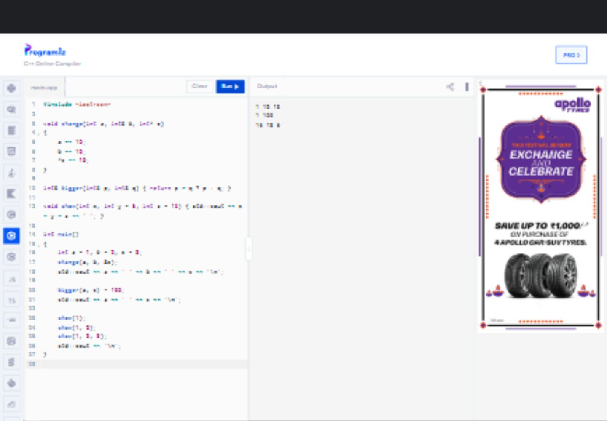
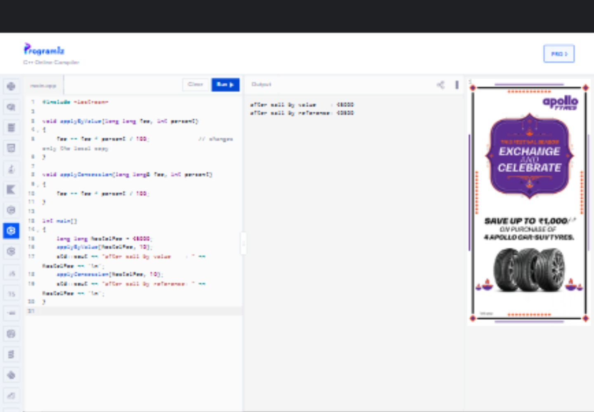
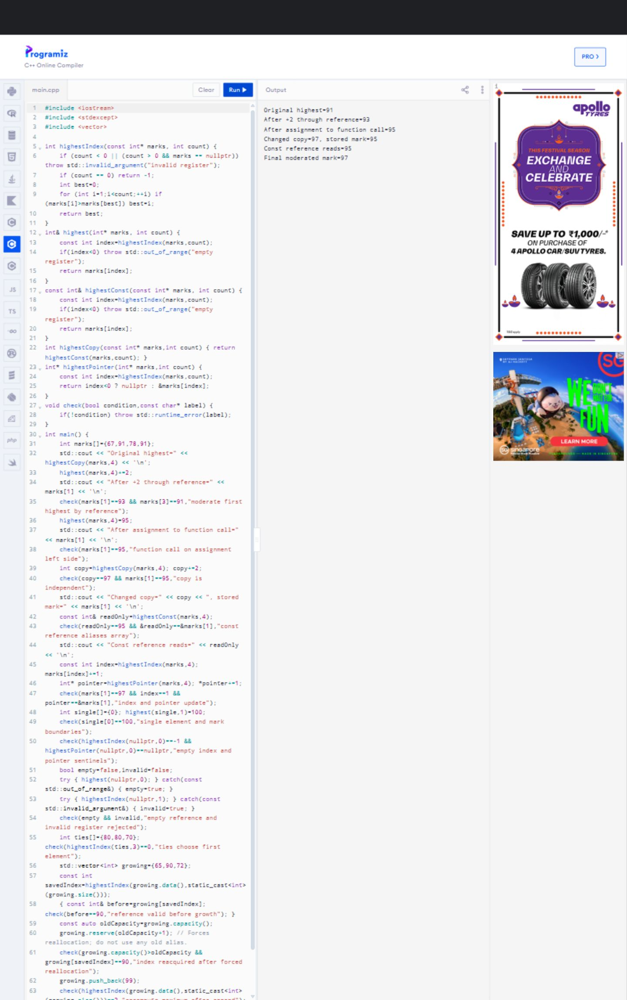
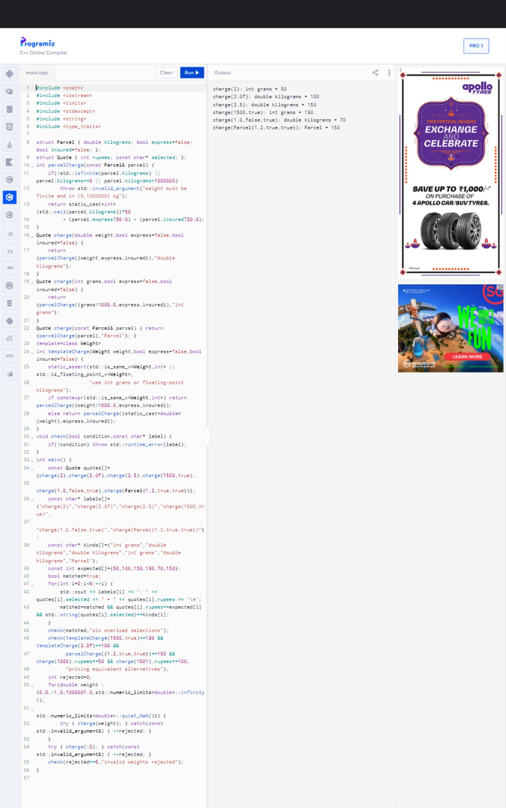
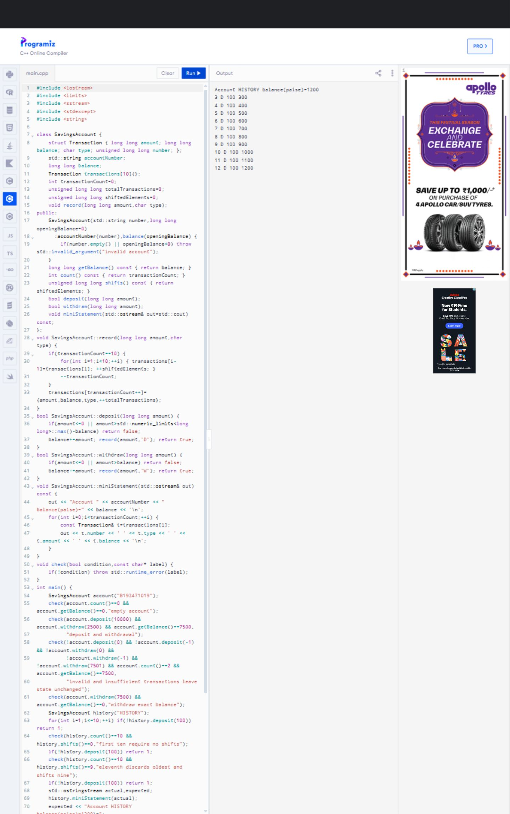
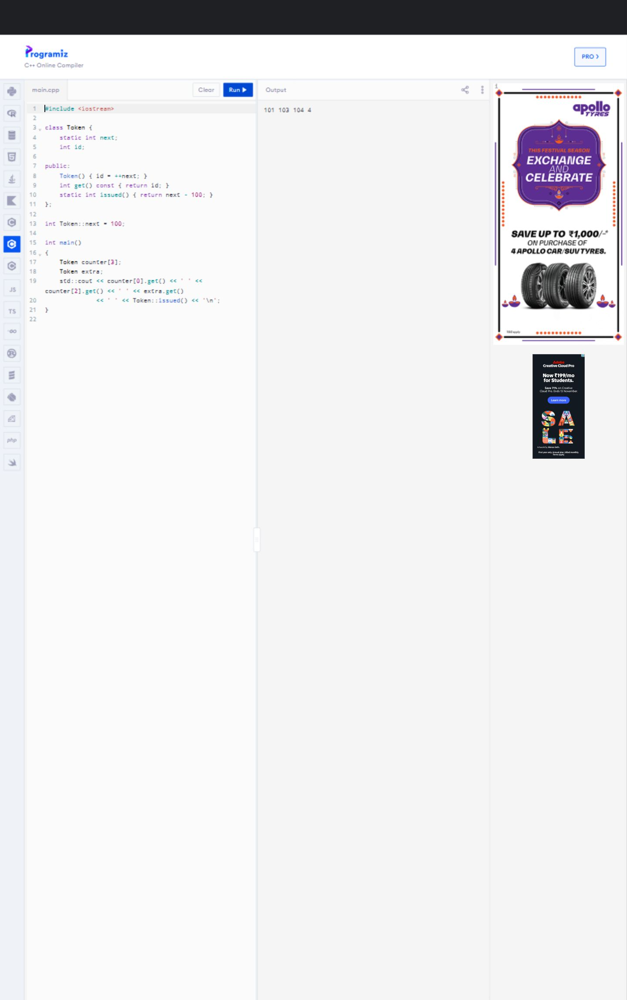
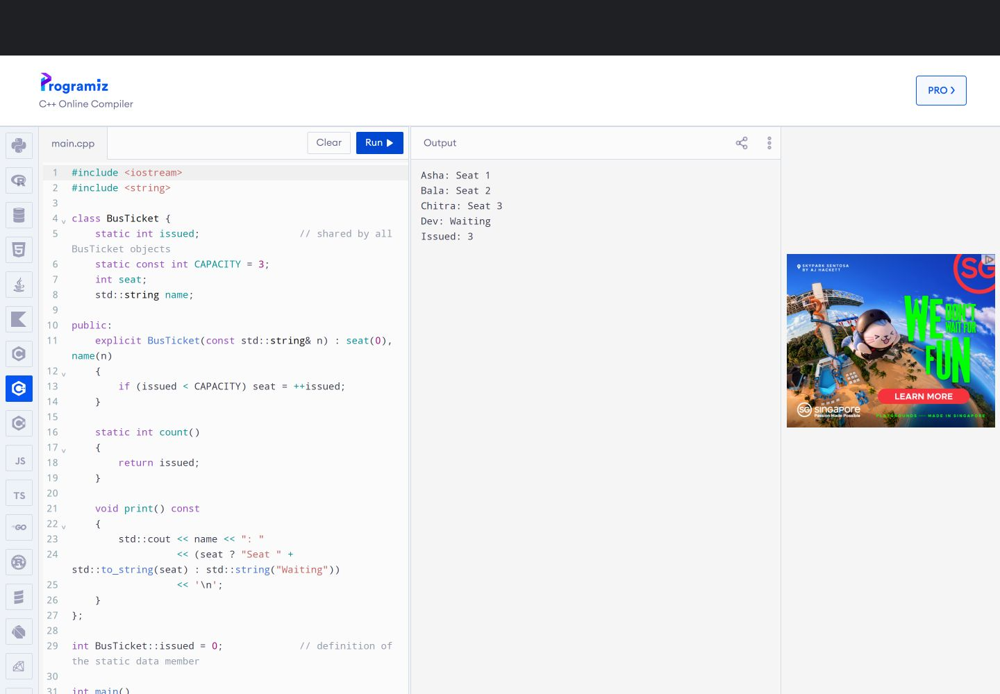
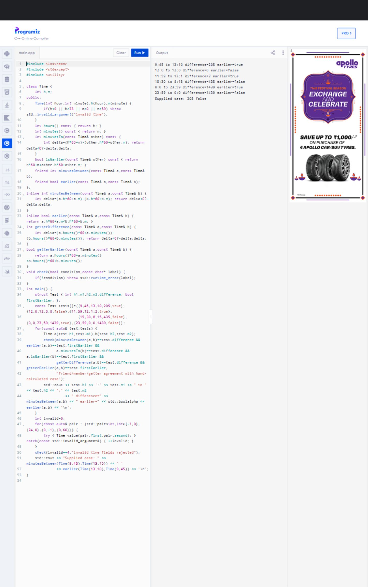
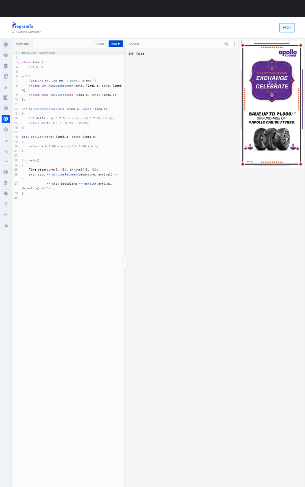
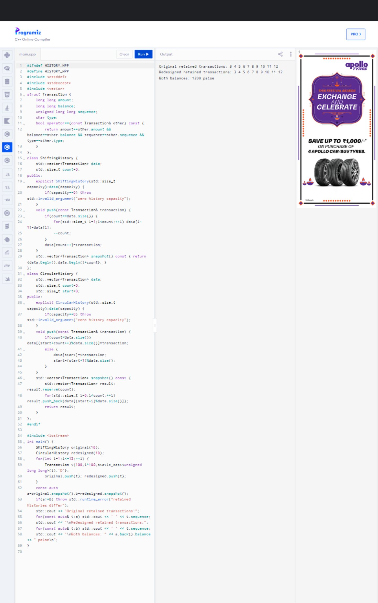

# DSA0110 - Assignment 2 (CO2)

Student: D Hoshea Paul

Register Number: 192471019

Slot: B

GitHub Repository: https://github.com/hosheapaul2006/DSA0110_SLOT-B-192471019-Assignment-2

## Scope, environment and evidence

Original problem statement: Reference/ASSIGNMENT 2.pdf, 15 pages, Q1-Q7, total 50 marks. Every question and Q7 section A-F is addressed. This report is supported by the complete C++ sources and raw evidence in the task folders.

Actual local execution date: 10 November 2026. Compiler: GCC 14.2.0 (WinLibs MinGW-w64 x86_64 UCRT POSIX SEH). Standard build: `g++ -std=c++17 -Wall -Wextra -Wpedantic -O0 source.cpp -o program.exe`. Benchmark builds also use `-O2`. Hardware/platform information is recorded below without personal machine identifiers.

```text
Windows-11-10.0.26300-SP0
Architecture: AMD64
CPU: AMD Ryzen AI 5 340 w/ Radeon 840M
```

Local evidence: 24 valid C++ source programs, 26 successful build/run configurations, two diagnostic-only sources, 12 actual Programiz program runs and 19 current genuine screenshots. Eight earlier screenshots remain with their initial execution records for provenance. The unsafe local-reference source was compiled but not executed.

Console demonstrations show coursework results; validation labels appear in separate validation sources/logs and test tables. Python scripts only orchestrate compilation, evidence auditing and report layout; they do not implement assignment solutions. No original prediction was rewritten after execution.

### Prediction chronology

| Prediction | Commit before execution | Outcome |
|---|---|---|
| Q1 supplied output and stored fees | c2a6ade | Matched |
| Q3 six overload selections | c9dd5c2 | Matched original validation output |
| Q5 Token | cbc5040 | Matched |
| Q7 performance objective/prediction | a8e1a25 | Objective achieved; raw trials retained |

The later console presentation change is documented in Reference/PREDICTION_HISTORY.md. The original Q3 prediction includes validation labels and belongs to the preserved original source now named validation.cpp; it is not presented as a prediction of the later clean-output main.cpp. Windows CRLF newlines are decoded to LF for comparisons; all other spaces and characters are retained. Programiz result-pane text was separately checked against local stdout, permitting only the platform success banner/trailing blank space after the full expected output.

### Submission and compliance notes

The existing public repository name is preserved at the user's request. The PDF requests DSA01-192471019-Assignment2, so faculty acceptance of the different name remains pending. Its deadline is 31 October 2026; these executions and progressive commits are dated 10 November 2026, with no backdating. The user will submit Classroom personally. Classroom was signed out during the access check; no course or assignment was selected. The PDF also requires the student to execute every task individually: these automated/browser-operated executions do not certify that personal step.

# Q1 - Call by Value, by Reference and by Pointer

## Problem statement and objective

Hostel fee concessions: implement value/reference/pointer passing, predict caller changes, defend the update interface, predict the supplied program, complete the reference TODO and compare copied storage. PDF pages 2-5; 6 marks.

## Q1 - Hostel fee concessions

Objective: show which parameter mechanisms update the caller, then choose an interface for multiple concessions.

`main.cpp` demonstrates merit 10%, sports 15% and single-parent 25% from independent 45000 fees. A value parameter is a separate local object; assigning it changes that copy. A reference parameter aliases the caller's object. A pointer parameter is itself copied but dereferencing its stored address accesses the caller's fee. A null pointer must be rejected; references require a valid object when bound.

### Algorithm

1. Validate fee >= 0 and percentage in [0,100].
2. Compute floor(fee * percent / 100); subtract the discount.
3. For reference or pointer interfaces, assign back to the caller's object.
4. To combine concessions, assign the returned new fee for each concession in order.

The main implementation splits quotient and remainder to avoid overflow in `fee * percent`. The supplied TODO uses the requested expression unchanged except for filling the TODO. Its demonstrated 45000 input is safely within range. Integer division truncates a nonnegative discount downward. Combining percentages is a different policy: sequential discounts give 25819, while adding rates to 50% would give 22500. Sequential application was selected explicitly; rounding occurs at each step.

### Prediction and supplied exercise

The prediction files were committed before the first run. `change` leaves a=1, changes b=12 and c=13. `bigger(a,c)` returns a reference to c, so assigning the call changes c to 100. For equal arguments the conditional chooses q. `show(1)` uses y=5,z=10; `show(1,2)` uses z=10; `show(1,2,3)` uses no defaults. The final output line ends with a space.

`complete_code.cpp` fills only TODO 1; `Reference/Q1_TODO_original.txt` preserves the original. Pass by value leaves the hostel fee at 45000 because no assignment to the original occurs. A const reference permits reading a large object without copying it and prohibits mutation through that parameter; it does not extend an arbitrary caller object's lifetime.

### Interface decision and alternatives

Keep all three interfaces for the demonstration. Prefer `fee = updatedFee(fee, percent)` when composing concessions: the assignment makes the update explicit, and calculating a candidate fee does not mutate existing state. A reference is convenient for a clearly named in-place operation. Pointer parameters are useful where optional/null arguments have a meaning, but add validation here.

| Parameter | Time | Extra parameter storage / copy | Mutation |
|---|---|---|---|
| long long by value | O(1) | sizeof(long long) | local only |
| long long reference / const reference | O(1) | typically one address; C++ does not mandate reference representation | mutable / read-only access |
| Student by value | O(S) in object size S | O(S) copied bytes | local only |
| Student reference / const reference | O(1) binding | O(1), no object copy | mutable / read-only access |
| pointer | O(1) | sizeof(pointer) copied | pointee can change |

For the fixed Student definition, S is constant and every call is O(1) as problem input grows; O(S) describes scaling the object. `sizeof` measurements in the actual output document the local ABI, not a required language-wide size. A trivially copied large object still costs memory bandwidth; optimizers can remove unobservable copies. References introduce aliasing and lifetime concerns. The program checks the boundary and negative cases without relying on timing guesses.


## Primary C++17 source

### main.cpp

```cpp
#include <iostream>
#include <limits>
#include <stdexcept>

long long updatedFee(long long fee, int percent) {
    if (fee < 0 || percent < 0 || percent > 100)
        throw std::invalid_argument("fee or percentage out of range");
    // Equivalent to fee * percent / 100 for nonnegative values, without overflow.
    const long long discount = (fee / 100) * percent + (fee % 100) * percent / 100;
    return fee - discount;
}
long long applyByValue(long long fee, int percent) {
    fee = updatedFee(fee, percent);
    return fee;
}
void applyByReference(long long& fee, int percent) { fee = updatedFee(fee, percent); }
void applyByPointer(long long* fee, int percent) {
    if (!fee) throw std::invalid_argument("null fee pointer");
    *fee = updatedFee(*fee, percent);
}
struct Student { char name[128]{}; long long fee{}; int marks[64]{}; };
long long readValue(Student student) { return student.fee; }
long long readConstReference(const Student& student) { return student.fee; }
void updateStudent(Student& student, int percent) { applyByReference(student.fee, percent); }

void check(bool condition, const char* label) {
    if (!condition) throw std::runtime_error(label);
}
int main() {
    const int rates[] = {10, 15, 25};
    const long long expected[] = {40500, 38250, 33750};
    for (int i = 0; i < 3; ++i) {
        long long valueFee=45000, referenceFee=45000, pointerFee=45000;
        const long long localFee=applyByValue(valueFee, rates[i]);
        applyByReference(referenceFee,rates[i]); applyByPointer(&pointerFee,rates[i]);
        std::cout << rates[i] << "%: local=" << localFee << " value=" << valueFee
                  << " reference=" << referenceFee << " pointer=" << pointerFee << '\n';
        check(localFee==expected[i] && valueFee==45000 && referenceFee==expected[i]
              && pointerFee==expected[i], "passing modes");
    }
    long long fee=45000;
    for (int rate:rates) fee=updatedFee(fee,rate);
    check(fee==25819,"sequential concessions and rounding");
    std::cout << "Sequential fee=" << fee << '\n';
    check(updatedFee(0,25)==0 && updatedFee(999,0)==999 && updatedFee(999,100)==0,
          "zero fee and 0/100 percent");
    check(updatedFee(std::numeric_limits<long long>::max(),100)==0,"large fee without overflow");
    for (int percent : {-1,101}) {
        bool rejected=false; try { updatedFee(100,percent); } catch(const std::invalid_argument&) { rejected=true; }
        check(rejected,"invalid percentage rejected");
    }
    bool negative=false, null=false;
    try { updatedFee(-1,10); } catch(const std::invalid_argument&) { negative=true; }
    try { applyByPointer(nullptr,10); } catch(const std::invalid_argument&) { null=true; }
    check(negative && null,"negative fee and null pointer rejected");
    Student student{}; student.fee=45000;
    check(readValue(student)==45000 && readConstReference(student)==45000,"large object reads");
    updateStudent(student,10); check(student.fee==40500,"large object reference mutation");
    std::cout << "sizeof(long long)=" << sizeof(long long) << " sizeof(Student)=" << sizeof(Student)
              << " sizeof(pointer)=" << sizeof(Student*) << '\n';
}
```

## Supplied output prediction

### predict_output.cpp

```cpp
#include <iostream> 
 
void change(int a, int& b, int* c) 
{ 
    a += 10; 
    b += 10; 
    *c += 10; 
} 
 
int& bigger(int& p, int& q) { return p > q ? p : q; } 
 
void show(int x, int y = 5, int z = 10) { std::cout << x + y + z << ' '; } 
 
int main() 
{ 
    int a = 1, b = 2, c = 3; 
    change(a, b, &c); 
    std::cout << a << ' ' << b << ' ' << c << '\n'; 
 
    bigger(a, c) = 100; 
    std::cout << a << ' ' << c << '\n'; 
 
    show(1); 
    show(1, 2); 
    show(1, 2, 3); 
    std::cout << '\n'; 
}
```

Exact prediction saved before execution:

### predicted_output.txt

```text
1 12 13
1 100
16 13 6
```

Actual output:

### predict_output_actual.txt

```text
1 12 13
1 100
16 13 6
```

## Predictions recorded before the first Q1 execution

Each independent demonstration begins at 45000 rupees.

| Concession | By value: inside / caller | By reference: caller | By pointer: caller |
|---|---|---|---|
| Merit 10% | 40500 / 45000 | 40500 | 40500 |
| Sports 15% | 38250 / 45000 | 38250 | 38250 |
| Single parent 25% | 33750 / 45000 | 33750 | 33750 |

Sequential return-value updates: 45000 -> 40500 -> 34425 -> 25819.
The last discount truncates 8606.25 to 8606, then subtracts it.
The supplied TODO program should print 45000 after value and 40500 after reference.

For the supplied prediction program, change modifies b and c only. bigger(a,c)
aliases c and assigns 100 to it. show uses defaults (5,10), then just 10, then none.
The third output line has a trailing space before its newline. The original
prediction is immutable after execution; any differences belong in comparison.md.


## Completed supplied TODO exercise

Only TODO regions are replaced. The original extracted source is in Reference; the audit verifies preservation.

### complete_code.cpp

```cpp
#include <iostream> 
 
void applyByValue(long long fee, int percent) 
{ 
    fee -= fee * percent / 100;              // changes only the local copy 
} 
 
void applyConcession(long long& fee, int percent) 
{ 
    fee -= fee * percent / 100;
} 
 
int main() 
{ 
    long long hostelFee = 45000; 
    applyByValue(hostelFee, 10); 
    std::cout << "after call by value    : " << hostelFee << '\n'; 
    applyConcession(hostelFee, 10); 
    std::cout << "after call by reference: " << hostelFee << '\n'; 
}
```

Supplied expected output:

### complete_expected.txt

```text
after call by value    : 45000
after call by reference: 40500
```

Actual executed output:

### complete_code_actual.txt

```text
after call by value    : 45000
after call by reference: 40500
```

## Executed test cases

## Q1 executed tests

| ID | Input / scenario | Expected result | Actual result | Status |
|---|---|---|---|---|
| 1 | 45000, 10% | local 40500; caller value 45000; reference/pointer 40500 | Exact values verified in main_actual.txt | PASS |
| 2 | 45000, 15% | local 38250; value 45000; reference/pointer 38250 | Exact values verified | PASS |
| 3 | 45000, 25% | local 33750; value 45000; reference/pointer 33750 | Exact values verified | PASS |
| 4 | Sequential 10%,15%,25% | 25819 | 25819 | PASS |
| 5 | Zero fee; 0% and 100% | 0; unchanged; 0 | All assertions passed | PASS |
| 6 | LLONG_MAX,100% | 0 without overflow | Assertion passed | PASS |
| 7 | -1%,101%; negative fee; null pointer | invalid_argument | Exceptions caught and checked | PASS |
| 8 | Student reads and reference update | 45000 reads; updated fee 40500 | Assertions passed | PASS |
| 9 | Supplied prediction | Exact precommitted prediction | Identical after newline decoding | PASS |
| 10 | Supplied TODO | 45000 then 40500 | Exact expected output comparison passed | PASS |

Evidence: outputs/*_verification.json, outputs/main_actual.txt, outputs/predict_output_actual.txt and outputs/complete_code_actual.txt. All three programs compiled warning-free at -O0. Inputs are deterministic and embedded in main; no stdin is needed.


## Actual console demonstration output

### main_actual.txt

```text
10%: local=40500 value=45000 reference=40500 pointer=40500
15%: local=38250 value=45000 reference=38250 pointer=38250
25%: local=33750 value=45000 reference=33750 pointer=33750
Sequential fee=25819
sizeof(long long)=8 sizeof(Student)=392 sizeof(pointer)=8
```

## Genuine Programiz evidence

The following images are actual browser captures after Run completed. The full capture files and result-pane text are retained in the repository. PDF panels show the upper portion when a full-page capture is taller than the landscape page; no output was substituted.






# Q2 - Return by Reference and Its Dangers

## Problem statement and objective

Examination marks register: return the highest element by reference, contrast copy/const-reference/index/pointer returns, capture a local-reference warning and evaluate vector growth. PDF pages 5-6; 4 marks.

## Q2 - Examination marks register

Objective: update the first highest mark directly while understanding alias lifetime.

### Algorithm and interfaces

Scan the nonempty register once, remember the index of the largest element, and replace the index only on a strict increase. This deterministically selects the first tie. Returning `marks[index]` as `int&` aliases an existing element, so `highest(marks,4) += 2` updates it and `highest(marks,4) = 95` is a valid assignment. Returning an int copies the value; changing the copy cannot change the register. `const int&` avoids a value copy but prevents assignment through that alias. It is not a snapshot and does not prevent another alias from changing the element.

Index calling code: `int i=highestIndex(marks,n); if(i>=0) marks[i]+=2;`.
Pointer calling code: `int* p=highestPointer(marks,n); if(p) *p+=2;`.
The reference/copy/const-reference interfaces throw for an empty register; index returns -1 and pointer returns null. Invalid negative length or nonempty null register is rejected. Raw pointer lengths must describe actual accessible storage; this API cannot discover an incorrect caller-provided positive length.

### Dangling reference and vector growth

`unsafe_local.cpp` returns an alias to an automatic local object. That object dies when its function returns. A reference does not keep it alive; using the dangling alias is undefined behaviour. The source is compiled with `-Wreturn-local-addr`, its real diagnostic is stored in outputs/unsafe_local_compiler.txt, and its executable is deliberately never run.

Vector reallocation moves/copies elements into new storage, invalidating all references, pointers and iterators into old storage. The executed vector test forces this with reserve(oldCapacity+1), then reacquires through a saved index. It does not read an invalid reference or pointer. Without reallocation, push_back preserves existing element aliases but invalidates the old end iterator. Erase/insert may shift elements even without reallocation. An index survives storage relocation if sequence positions stay the same, but is not a permanent identity and need not still identify the maximum after growth. The append-99 test explicitly recomputes the maximum.

### Comparison and design decision

| Return type | Search time | Auxiliary space | After array/vector storage changes |
|---|---|---|---|
| int& | O(n) | O(1) | may dangle; cannot represent empty directly |
| const int& | O(n) | O(1) | same lifetime risk; read-only through this alias |
| int copy | O(n) | O(1) | independent snapshot; cannot update original |
| int index | O(n) | O(1) | can reacquire after reallocation; validate bounds/meaning |
| int* | O(n) | O(1) | can be null, but may dangle like a reference |

The returned primitive itself is constant size in every case. Prefer an index with immediate bounds-checked reacquisition for a growing register. Recompute when the question is 'current highest'. A fixed array with a controlled lifetime is suitable for the reference demonstration; do not expose a long-lived mutable alias to a reallocating vector.


## Primary C++17 source

### main.cpp

```cpp
#include <iostream>
#include <stdexcept>
#include <vector>

int highestIndex(const int* marks, int count) {
    if (count < 0 || (count > 0 && marks == nullptr)) throw std::invalid_argument("invalid register");
    if (count == 0) return -1;
    int best=0;
    for (int i=1;i<count;++i) if (marks[i]>marks[best]) best=i;
    return best;
}
int& highest(int* marks, int count) {
    const int index=highestIndex(marks,count);
    if(index<0) throw std::out_of_range("empty register");
    return marks[index];
}
const int& highestConst(const int* marks, int count) {
    const int index=highestIndex(marks,count);
    if(index<0) throw std::out_of_range("empty register");
    return marks[index];
}
int highestCopy(const int* marks,int count) { return highestConst(marks,count); }
int* highestPointer(int* marks,int count) {
    const int index=highestIndex(marks,count);
    return index<0 ? nullptr : &marks[index];
}
void check(bool condition,const char* label) {
    if(!condition) throw std::runtime_error(label);
}
int main() {
    int marks[]={67,91,78,91};
    std::cout << "Original highest=" << highestCopy(marks,4) << '\n';
    highest(marks,4)+=2;
    std::cout << "After +2 through reference=" << marks[1] << '\n';
    check(marks[1]==93 && marks[3]==91,"moderate first highest by reference");
    highest(marks,4)=95;
    std::cout << "After assignment to function call=" << marks[1] << '\n';
    check(marks[1]==95,"function call on assignment left side");
    int copy=highestCopy(marks,4); copy+=2;
    check(copy==97 && marks[1]==95,"copy is independent");
    std::cout << "Changed copy=" << copy << ", stored mark=" << marks[1] << '\n';
    const int& readOnly=highestConst(marks,4);
    check(readOnly==95 && &readOnly==&marks[1],"const reference aliases array");
    std::cout << "Const reference reads=" << readOnly << '\n';
    const int index=highestIndex(marks,4); marks[index]+=1;
    int* pointer=highestPointer(marks,4); *pointer+=1;
    check(marks[1]==97 && index==1 && pointer==&marks[1],"index and pointer update");
    int single[]={0}; highest(single,1)=100;
    check(single[0]==100,"single element and mark boundaries");
    check(highestIndex(nullptr,0)==-1 && highestPointer(nullptr,0)==nullptr,"empty index and pointer sentinels");
    bool empty=false,invalid=false;
    try { highest(nullptr,0); } catch(const std::out_of_range&) { empty=true; }
    try { highestIndex(nullptr,1); } catch(const std::invalid_argument&) { invalid=true; }
    check(empty && invalid,"empty reference and invalid register rejected");
    int ties[]={80,80,70}; check(highestIndex(ties,3)==0,"ties choose first element");
    std::vector<int> growing={65,90,72};
    const int savedIndex=highestIndex(growing.data(),static_cast<int>(growing.size()));
    { const int& before=growing[savedIndex]; check(before==90,"reference valid before growth"); }
    const auto oldCapacity=growing.capacity();
    growing.reserve(oldCapacity+1); // Forces reallocation; do not use any old alias.
    check(growing.capacity()>oldCapacity && growing[savedIndex]==90,"index reacquired after forced reallocation");
    growing.push_back(99);
    check(highestIndex(growing.data(),static_cast<int>(growing.size()))==3,"recompute maximum after append");
    std::cout << "Final moderated mark=" << marks[1] << '\n';
}
```

## Deliberately unsafe diagnostic-only source

This source was not executed.

### unsafe_local.cpp

```cpp
// Diagnostic-only negative example. Never execute this demonstration.
int& danglingReference() {
    int localMark=90;
    return localMark;
}
int main() { return 0; }
```

### unsafe_local_compiler.txt

```text
C:\Projects\SLOT B\DSA0110_SLOT-B-192471019-Assignment-2\Task02\unsafe_local.cpp: In function 'int& danglingReference()':
C:\Projects\SLOT B\DSA0110_SLOT-B-192471019-Assignment-2\Task02\unsafe_local.cpp:4:12: warning: reference to local variable 'localMark' returned [-Wreturn-local-addr]
    4 |     return localMark;
      |            ^~~~~~~~~
C:\Projects\SLOT B\DSA0110_SLOT-B-192471019-Assignment-2\Task02\unsafe_local.cpp:3:9: note: declared here
    3 |     int localMark=90;
      |         ^~~~~~~~~
```

## Executed test cases

## Q2 test plan and evidence

| ID | Input / scenario | Expected result | Actual result | Status |
|---|---|---|---|---|
| 1 | {67,91,78,91}, +2 | First 91 becomes 93 | Checked in main_actual.txt | PASS |
| 2 | highest(...)=95 | Array element becomes 95 | Checked | PASS |
| 3 | Copy plus two | Copy 97, array 95 | Checked | PASS |
| 4 | Const reference | Address matches element, value 95 | Checked | PASS |
| 5 | Index then pointer increments | Element 97 | Checked | PASS |
| 6 | Single 0 updated to 100; tied maxima | 100; first tie index 0 | Checked | PASS |
| 7 | Empty register | -1/null; reference throws | Checked | PASS |
| 8 | Nonempty null register | invalid_argument | Checked | PASS |
| 9 | reserve(capacity+1), append99 | Reacquired 90; new maximum index3 | Checked without using old aliases | PASS |
| 10 | Return local reference, compile only | GCC local-reference warning | See unsafe_local_compiler.txt | PASS |

The statuses apply only after the accompanying verification JSON records successful execution/diagnostic checks. The diagnostic-only source is never executed. Inputs are embedded in the sources; no stdin.


## Actual console demonstration output

### main_actual.txt

```text
Original highest=91
After +2 through reference=93
After assignment to function call=95
Changed copy=97, stored mark=95
Const reference reads=95
Final moderated mark=97
```

## Genuine Programiz evidence

The following images are actual browser captures after Run completed. The full capture files and result-pane text are retained in the repository. PDF panels show the upper portion when a full-page capture is taller than the landscape page; no output was substituted.



# Q3 - Default Arguments and Function Overloading

## Problem statement and objective

Courier calculator: diagnose ambiguous declarations, combine defaults with int-grams/double-kg/Parcel overloads, predict six selections and compare a request structure and template. PDF page 6; 6 marks.

## Q3 - Courier charge calculator

The PDF gives no monetary tariff. The documented illustrative rule, selected before implementation, is Rs 50 per started kilogram plus Rs 30 express and Rs 20 insurance. Integer input means grams; floating input means kilograms. Optional booleans default to false. Nonfinite, nonpositive and over-one-million-kilogram weights are rejected to keep pricing arithmetic in int range. This is an example policy, not a real courier tariff.

### Diagnose and redesign

`ambiguity.cpp` retains the three declarations from the PDF and adds the two ambiguous calls. The one- and two-argument declarations compete with the three-argument declaration using defaults. Default use does not make an otherwise identical match worse. GCC's genuine errors are in outputs/ambiguity_compiler.txt. This is an expected negative test, not a broken delivered implementation.

The working design has exactly one numeric overload per unit type: `charge(int,bool=false,bool=false)` and `charge(double,bool=false,bool=false)`, plus `charge(const Parcel&)`. All route to one tariff calculation. Pseudocode: validate kilograms; ceiling to started kilograms; multiply by 50; add requested option charges. The six predicted selections are in outputs/overload_predictions.md and their exact predicted output was committed before running the original main.cpp, now preserved as validation.cpp. The later presentation main.cpp suppresses validation labels; the original prediction and execution are preserved under outputs/initial_execution and Reference/PREDICTION_HISTORY.md.

An exact match ranks ahead of a promotion, which ranks ahead of other standard conversions. For charge(2), int is exact. For charge(2.0f), float-to-double is a promotion whereas float-to-int is a conversion. Default arguments fill omitted trailing parameters; in these ordinary declarations, once a parameter has a default all following parameters must have defaults visible in the declaration. There is no syntax for skipping a middle positional argument. Return types do not choose an overload. Overload resolution occurs at compile time; it adds no runtime dispatch.

The delivered six calls are unambiguous. This is not a claim that arbitrary unrelated user-defined input types can never produce ambiguity: callers should use the documented int, floating-point, or Parcel inputs. In particular a type convertible equally well to both numeric overloads may require an explicit cast.

### Alternatives and complexity

| Design | Runtime / auxiliary space | Copying | Adding a new option |
|---|---|---|---|
| Overloads with defaults | O(1) / O(1) | scalar values, Parcel passed by const reference | update numeric wrappers and shared calculation |
| Single const Parcel& | O(1) / O(1) | no object copy at entry; caller owns a fixed-size object | add a defaulted field; call sites can stay short |
| Constrained template | O(1) / O(1) | scalar Weight by value | modify template/wrapper and calculation |

`parcelCharge` implements the single-structure alternative and `templateCharge` implements a C++17 compile-time integral/floating branch. Both are exercised. Template instantiations may increase code size and can obscure the units policy unless constrained. Compile-time lookup/instantiation costs are not runtime Big-O costs and were not benchmarked. A temporary Parcel is fixed size and O(1) to construct. Prefer the overloads for this teaching exercise; for many future options, a named Parcel request scales better than a long list of positional booleans.


## Primary C++17 source

### main.cpp

```cpp
#include <cmath>
#include <iostream>
#include <limits>
#include <stdexcept>
#include <string>
#include <type_traits>

struct Parcel { double kilograms; bool express=false; bool insured=false; };
struct Quote { int rupees; const char* selected; };
int parcelCharge(const Parcel& parcel) {
    if(!std::isfinite(parcel.kilograms) || parcel.kilograms<=0 || parcel.kilograms>1000000)
        throw std::invalid_argument("weight must be finite and in (0,1000000] kg");
    return static_cast<int>(std::ceil(parcel.kilograms))*50
         + (parcel.express?30:0) + (parcel.insured?20:0);
}
Quote charge(double weight,bool express=false,bool insured=false) {
    return {parcelCharge({weight,express,insured}),"double kilograms"};
}
Quote charge(int grams,bool express=false,bool insured=false) {
    return {parcelCharge({grams/1000.0,express,insured}),"int grams"};
}
Quote charge(const Parcel& parcel) { return {parcelCharge(parcel),"Parcel"}; }
template<class Weight>
int templateCharge(Weight weight,bool express=false,bool insured=false) {
    static_assert(std::is_same_v<Weight,int> || std::is_floating_point_v<Weight>,
                  "use int grams or floating-point kilograms");
    if constexpr(std::is_same_v<Weight,int>) return parcelCharge({weight/1000.0,express,insured});
    else return parcelCharge({static_cast<double>(weight),express,insured});
}
void check(bool condition,const char* label) {
    if(!condition) throw std::runtime_error(label);
}
int main() {
    const Quote quotes[]={charge(2),charge(2.0f),charge(2.5),charge(1500,true),
                          charge(1.0,false,true),charge(Parcel{1.2,true,true})};
    const char* labels[]={"charge(2)","charge(2.0f)","charge(2.5)","charge(1500,true)",
                          "charge(1.0,false,true)","charge(Parcel{1.2,true,true})"};
    const char* kinds[]={"int grams","double kilograms","double kilograms","int grams","double kilograms","Parcel"};
    const int expected[]={50,100,150,130,70,150};
    bool matched=true;
    for(int i=0;i<6;++i) {
        std::cout << labels[i] << ": " << quotes[i].selected << " = " << quotes[i].rupees << '\n';
        matched=matched && quotes[i].rupees==expected[i] && std::string(quotes[i].selected)==kinds[i];
    }
    check(matched,"six overload selections");
    check(templateCharge(1500,true)==130 && templateCharge(2.0f)==100 &&
          parcelCharge({1.2,true,true})==150 && charge(1000).rupees==50 && charge(1001).rupees==100,
          "pricing equivalent alternatives");
    int rejected=0;
    for(double weight : {0.0,-1.0,1000001.0,std::numeric_limits<double>::infinity(),
                         std::numeric_limits<double>::quiet_NaN()}) {
        try { charge(weight); } catch(const std::invalid_argument&) { ++rejected; }
    }
    try { charge(-2); } catch(const std::invalid_argument&) { ++rejected; }
    check(rejected==6,"invalid weights rejected");
}
```

## Original overload prediction and diagnostic

## Predictions before execution

| Call | Selected overload | Reason |
|---|---|---|
| charge(2) | int grams | exact int match beats int-to-double conversion |
| charge(2.0f) | double kilograms | float-to-double promotion beats float-to-int conversion |
| charge(2.5) | double kilograms | exact double match |
| charge(1500,true) | int grams | exact int and bool; third argument defaults false |
| charge(1.0,false,true) | double kilograms | exact double and bool matches |
| charge(Parcel{1.2,true,true}) | const Parcel& | binds Parcel; no numeric overload is viable |

For the separate original declarations, charge(2.0) is ambiguous between the
one-argument overload and the three-argument overload using two defaults.
charge(2.0,true) is ambiguous between the two-argument and three-argument forms.
These predictions and the exact expected demonstration output are committed
before compiling/running the corresponding programs.


### predicted_output.txt

```text
charge(2): int grams = 50
charge(2.0f): double kilograms = 100
charge(2.5): double kilograms = 150
charge(1500,true): int grams = 130
charge(1.0,false,true): double kilograms = 70
charge(Parcel{1.2,true,true}): Parcel = 150
PASS six overload selections
PASS pricing equivalent alternatives
PASS invalid weights rejected
```

### main_actual.txt

```text
charge(2): int grams = 50
charge(2.0f): double kilograms = 100
charge(2.5): double kilograms = 150
charge(1500,true): int grams = 130
charge(1.0,false,true): double kilograms = 70
charge(Parcel{1.2,true,true}): Parcel = 150
PASS six overload selections
PASS pricing equivalent alternatives
PASS invalid weights rejected
```

### ambiguity.cpp

```cpp
double charge(double weight);
double charge(double weight, bool express);
double charge(double weight, bool express = false, bool insured = false);
int main() {
    charge(2.0);       // Deliberately ambiguous: one-argument vs defaults.
    charge(2.0,true);  // Deliberately ambiguous: two-argument vs defaults.
}
```

### ambiguity_compiler.txt

```text
C:\Projects\SLOT B\DSA0110_SLOT-B-192471019-Assignment-2\Task03\ambiguity.cpp: In function 'int main()':
C:\Projects\SLOT B\DSA0110_SLOT-B-192471019-Assignment-2\Task03\ambiguity.cpp:5:11: error: call of overloaded 'charge(double)' is ambiguous
    5 |     charge(2.0);       // Deliberately ambiguous: one-argument vs defaults.
      |     ~~~~~~^~~~~
C:\Projects\SLOT B\DSA0110_SLOT-B-192471019-Assignment-2\Task03\ambiguity.cpp:1:8: note: candidate: 'double charge(double)'
    1 | double charge(double weight);
      |        ^~~~~~
C:\Projects\SLOT B\DSA0110_SLOT-B-192471019-Assignment-2\Task03\ambiguity.cpp:3:8: note: candidate: 'double charge(double, bool, bool)'
    3 | double charge(double weight, bool express = false, bool insured = false);
      |        ^~~~~~
C:\Projects\SLOT B\DSA0110_SLOT-B-192471019-Assignment-2\Task03\ambiguity.cpp:6:11: error: call of overloaded 'charge(double, bool)' is ambiguous
    6 |     charge(2.0,true);  // Deliberately ambiguous: two-argument vs defaults.
      |     ~~~~~~^~~~~~~~~~
C:\Projects\SLOT B\DSA0110_SLOT-B-192471019-Assignment-2\Task03\ambiguity.cpp:2:8: note: candidate: 'double charge(double, bool)'
    2 | double charge(double weight, bool express);
      |        ^~~~~~
C:\Projects\SLOT B\DSA0110_SLOT-B-192471019-Assignment-2\Task03\ambiguity.cpp:3:8: note: candidate: 'double charge(double, bool, bool)'
    3 | double charge(double weight, bool express = false, bool insured = false);
      |        ^~~~~~
```

## Executed test cases

## Q3 executed tests

| ID | Input / scenario | Expected result | Actual result | Status |
|---|---|---|---|---|
| 1-6 | Six precommitted calls | int,double,double,int,double,Parcel; 50,100,150,130,70,150 | Exact character comparison passed | PASS |
| 7 | 1000 and 1001 grams | Rs50 and Rs100 | C++ checks passed | PASS |
| 8 | Parcel and template alternatives | Same tariff | Checks passed | PASS |
| 9 | 0,-1,1000001,inf,NaN kg; -2 grams | Six invalid_argument exceptions | Six caught | PASS |
| 10 | Original declarations and two calls | Ambiguous compiler errors | Genuine GCC diagnostic captured | PASS |

See outputs/main_actual.txt, main_verification.json and ambiguity_compiler.txt. Inputs are embedded; no stdin. Prediction comparison normalizes only platform newline encoding. No original prediction was changed.


## Actual console demonstration output

### main_actual.txt

```text
charge(2): int grams = 50
charge(2.0f): double kilograms = 100
charge(2.5): double kilograms = 150
charge(1500,true): int grams = 130
charge(1.0,false,true): double kilograms = 70
charge(Parcel{1.2,true,true}): Parcel = 150
```

## Genuine Programiz evidence

The following images are actual browser captures after Run completed. The full capture files and result-pane text are retained in the repository. PDF panels show the upper portion when a full-page capture is taller than the landscape page; no output was substituted.



# Q4 - Savings Account Mini-Statement

## Problem statement and objective

Savings account: private account/balance/ten-transaction array/count, inside/outside member definitions, correct last-ten retention, 11th transaction handling and capacity50 alternatives. PDF page 7; 6 marks.

## Q4 - Savings account mini-statement

The class stores its account number, nonnegative balance, fixed Transaction[10], and transaction count privately. Each successful operation records an amount, resulting balance, type and sequence number. Deposits/withdrawals take integer paise. Failed operations do not change balance or history. Opening balances are not transactions. The constructor and simple observers are defined inside the class; deposit, withdraw, record and miniStatement use `SavingsAccount::` outside it.

Private data prevents callers from manufacturing a false balance, count or transaction. The statement prints oldest to newest. It exposes output rather than mutable internal storage. This is a single-threaded educational model with no interest, transfers, persistent storage or concurrency.

### Original algorithm and evidence

Validate amount and funds/overflow before mutation. Update balance. If history is full, copy entries 1..9 into 0..8 and reduce count to 9. Append the new record and restore count to 10. The 11th transaction discards transaction 1 and makes exactly nine record shifts. The 12th discards transaction 2. The executed complete-statement comparison verifies transactions 3..12 in order and the correct balances.

`baseline_growth.cpp` generalizes only the original shifting strategy to k=10,50,1000. It performs 100000 full-history insertions, counts assignments, times the loop, and checks final contents with a closed-form sum. Its measured outputs supply original-design evidence for Q7; no redesign exists yet in this task.

### Alternatives and changed capacity

| Storage | Add full history | Statement | Storage | Trade-off |
|---|---|---|---|---|
| Shifted array | O(k) | O(k) | O(k), contiguous | simplest physical chronological order |
| Circular array | O(1) | O(k) | O(k) plus start/count | wrapped logical ordering |
| deque | O(1) end insertion/front removal | O(k) | O(k) plus block/allocation overhead | easy growth, noncontiguous storage |

Circular pseudocode: if count<k, write at (start+count)%k and increment count; otherwise overwrite at start and set start=(start+1)%k. Print element (start+i)%k for i=0..count-1. Deque pseudocode: push_back(record); if size>k pop_front().

The literal ten-entry original class demonstrates the assignment's fixed array. A named capacity/template parameter lets either array design change from 10 to 50 with one capacity change. A deque limit similarly changes with one constant. Thus a ring does not uniquely require fewer source edits than a properly parameterized shifting array; its advantage is stable update work. At k=50 the original full update moves 49 records rather than nine. For a literal fixed k=10, O(k) is O(1) with respect to the number of transactions; the growth comparison treats capacity as a variable. Prefer a circular array when bounded storage and larger history are required, contingent on measured costs in Q7. For ten records and rare updates, shifting may remain clearer.


## Primary C++17 source

### main.cpp

```cpp
#include <iostream>
#include <limits>
#include <sstream>
#include <stdexcept>
#include <string>

class SavingsAccount {
    struct Transaction { long long amount; long long balance; char type; unsigned long long number; };
    std::string accountNumber;
    long long balance;
    Transaction transactions[10]{};
    int transactionCount=0;
    unsigned long long totalTransactions=0;
    unsigned long long shiftedElements=0;
    void record(long long amount,char type);
public:
    SavingsAccount(std::string number,long long openingBalance=0)
      :accountNumber(number),balance(openingBalance) {
        if(number.empty() || openingBalance<0) throw std::invalid_argument("invalid account");
    }
    long long getBalance() const { return balance; }
    int count() const { return transactionCount; }
    unsigned long long shifts() const { return shiftedElements; }
    bool deposit(long long amount);
    bool withdraw(long long amount);
    void miniStatement(std::ostream& out=std::cout) const;
};
void SavingsAccount::record(long long amount,char type) {
    if(transactionCount==10) {
        for(int i=1;i<10;++i) { transactions[i-1]=transactions[i]; ++shiftedElements; }
        --transactionCount;
    }
    transactions[transactionCount++]={amount,balance,type,++totalTransactions};
}
bool SavingsAccount::deposit(long long amount) {
    if(amount<=0 || amount>std::numeric_limits<long long>::max()-balance) return false;
    balance+=amount; record(amount,'D'); return true;
}
bool SavingsAccount::withdraw(long long amount) {
    if(amount<=0 || amount>balance) return false;
    balance-=amount; record(amount,'W'); return true;
}
void SavingsAccount::miniStatement(std::ostream& out) const {
    out << "Account " << accountNumber << " balance(paise)=" << balance << '\n';
    for(int i=0;i<transactionCount;++i) {
        const Transaction& t=transactions[i];
        out << t.number << ' ' << t.type << ' ' << t.amount << ' ' << t.balance << '\n';
    }
}
void check(bool condition,const char* label) {
    if(!condition) throw std::runtime_error(label);
}
int main() {
    SavingsAccount account("B192471019");
    check(account.count()==0 && account.getBalance()==0,"empty account");
    check(account.deposit(10000) && account.withdraw(2500) && account.getBalance()==7500,
          "deposit and withdrawal");
    check(!account.deposit(0) && !account.deposit(-1) && !account.withdraw(0) &&
          !account.withdraw(-1) && !account.withdraw(7501) && account.count()==2 && account.getBalance()==7500,
          "invalid and insufficient transactions leave state unchanged");
    check(account.withdraw(7500) && account.getBalance()==0,"withdraw exact balance");
    SavingsAccount history("HISTORY");
    for(int i=1;i<=10;++i) if(!history.deposit(100)) return 1;
    check(history.count()==10 && history.shifts()==0,"first ten require no shifts");
    if(!history.deposit(100)) return 1;
    check(history.count()==10 && history.shifts()==9,"eleventh discards oldest and shifts nine");
    if(!history.deposit(100)) return 1;
    std::ostringstream actual,expected;
    history.miniStatement(actual);
    expected << "Account HISTORY balance(paise)=1200\n";
    for(int i=3;i<=12;++i) expected << i << " D 100 " << i*100 << '\n';
    check(actual.str()==expected.str(),"last ten are transactions 3 through 12 in chronological order");
    check(history.shifts()==18,"two full-buffer insertions move eighteen records");
    SavingsAccount large("LARGE",std::numeric_limits<long long>::max());
    check(!large.deposit(1) && large.count()==0,"balance overflow rejected");
    bool rejected=false;
    try { SavingsAccount invalid("",-1); } catch(const std::invalid_argument&) { rejected=true; }
    check(rejected,"invalid opening account rejected");
    history.miniStatement();
}
```

## Original growth evidence

### baseline_growth.cpp

```cpp
#include <chrono>
#include <cstdint>
#include <iostream>
#include <vector>

// Original shifting strategy with variable capacity for the growth experiment.
int main() {
    constexpr int updates=100000;
    std::cout << "capacity,updates,shift_assignments,milliseconds,checksum\n";
    for(int capacity:{10,50,1000}) {
        std::vector<long long> records(static_cast<std::size_t>(capacity),0);
        std::uint64_t assignments=0;
        const auto start=std::chrono::steady_clock::now();
        for(int i=1;i<=updates;++i) {
            for(int j=1;j<capacity;++j) { records[j-1]=records[j]; ++assignments; }
            records[capacity-1]=i;
        }
        const auto stop=std::chrono::steady_clock::now();
        long long checksum=0; for(long long record:records) checksum+=record;
        const long long expected=static_cast<long long>(capacity)*(2LL*updates-capacity+1)/2;
        if(checksum!=expected || assignments!=static_cast<std::uint64_t>(updates)*(capacity-1)) return 1;
        std::cout << capacity << ',' << updates << ',' << assignments << ','
                  << std::chrono::duration<double,std::milli>(stop-start).count() << ',' << checksum << '\n';
    }
}
```

### baseline_growth_actual.txt

```text
capacity,updates,shift_assignments,milliseconds,checksum
10,100000,900000,1.7393,999955
50,100000,4900000,10.5686,4998775
1000,100000,99900000,175.542,99500500
```

## Executed test cases

## Q4 executed tests

| ID | Input / scenario | Expected result | Actual result | Status |
|---|---|---|---|---|
| 1 | New zero account | count0,balance0 | Checked | PASS |
| 2 | Deposit10000,withdraw2500 paise | 7500, two records | Checked | PASS |
| 3 | 0/negative amounts,withdraw7501 | Reject all; unchanged balance/history | Checked | PASS |
| 4 | Withdraw7500 | Balance0 | Checked | PASS |
| 5 | First10 deposits | count10,zero shifts | Checked | PASS |
| 6 | 11th deposit | count10,nine shifts | Checked | PASS |
| 7 | 12th deposit | Exact complete statement for records3..12; 18 shifts | String comparison passed | PASS |
| 8 | LLONG_MAX balance +1 | Rejected; no transaction | Checked | PASS |
| 9 | Invalid opening account | invalid_argument | Caught | PASS |
| 10 | k=10,50,1000; 100000 full-history inserts | Assignments=(k-1)*100000; final arithmetic-series checksum | Checked in baseline_growth_actual.txt | PASS |

Evidence: outputs/*_verification.json and *_actual.txt. Main and baseline compiled at -O0; timings are actual local measurements, not Programiz timings. No stdin required.


## Actual console demonstration output

### main_actual.txt

```text
Account HISTORY balance(paise)=1200
3 D 100 300
4 D 100 400
5 D 100 500
6 D 100 600
7 D 100 700
8 D 100 800
9 D 100 900
10 D 100 1000
11 D 100 1100
12 D 100 1200
```

## Genuine Programiz evidence

The following images are actual browser captures after Run completed. The full capture files and result-pane text are retained in the repository. PDF panels show the upper portion when a full-page capture is taller than the landscape page; no output was substituted.



# Q5 - Static Members and Arrays of Objects

## Problem statement and objective

Bus tickets: derive static state from the shared-data principle, construct an oversized array, show waiting and static persistence, predict Token and complete the supplied TODOs. PDF pages 7-11; 7 marks.

## Q5 - College bus tickets

Principle: seat issuance state belongs to the class as a whole, so one private static `issued` counter is shared by all tickets. Each ticket holds its own passenger name and seat. The constructor assigns ++issued while below capacity, otherwise leaves seat zero to represent waiting. Waiting tickets do not inflate the number of seats issued. The out-of-class `int BusTicket::issued=0;` is a definition that allocates the shared object. C++17 also allows inline static definitions, but the supplied style is retained.

### Algorithm and lifecycle

Validate the passenger; if issued<capacity increment issued and store that seat; otherwise store zero. Print either Seat N or Waiting. Static count() returns issued and is called as BusTicket::count() without a ticket. A static member function has no this pointer, so it cannot access any particular object's seat/name without an explicit object.

An initialized array constructs each element in increasing index order. Five tickets with capacity three get 1,2,3,0,0. createTickets() constructs two more tickets and is called twice; all remain waiting and the static count stays three. Automatic ticket objects die on return, but the static counter remains until program termination. This model counts seats ever issued for one trip; destruction is not cancellation and never frees a seat. Waiting is a recorded status; automatic queue promotion/cancellation is outside the stated exercise. Starting another bus requires distinct office state, not secretly resetting a shared static counter.

The independent implementation deletes copying to avoid duplicating a seat by ordinary copies. C++17 guaranteed copy elision permits the array's direct prvalue initialization. This restriction is deliberately not added to the supplied TODO exercise: only its two TODOs change.

### Supplied programs and prediction

Token's static next starts at 100 because of its out-of-class initializer. Four constructors issue 101..104. The requested printed IDs are 101,103,104 and issued() is 4. The prediction was committed before execution and remains unchanged. The BusTicket TODO prints the exact expected Asha/Bala/Chitra/Dev output. Original text is preserved in Reference; only TODO regions were replaced.

### Alternatives

| Design | Issue time / extra space per issue | Shared state | Encapsulation / two buses |
|---|---|---|---|
| Static class counter | O(1) / O(1) | one counter per class | private but globally shared across class instances |
| Global counter | O(1) / O(1) | one global counter | easy accidental modification; still one bus unless generalized |
| TicketOffice | O(1) / O(1) | one counter per office/bus | private state, independently configurable capacities |

Names take O(L) character storage/copy time, where L is name length, in addition to constant seat bookkeeping. n tickets use O(n + sum L) storage. A single bus needs one counter in all alternatives; b independently tracked buses need O(b) counters. The main program executes both alternatives, including independent buses and a zero-capacity bus. Prefer TicketOffice for multiple buses; static BusTicket is clear for the assignment's one-bus model.


## Primary C++17 source

### main.cpp

```cpp
#include <iostream>
#include <stdexcept>
#include <string>

class BusTicket {
    static int issued;
    static constexpr int capacity=3;
    int seat;
    std::string name;
public:
    explicit BusTicket(const std::string& passenger) : seat(0),name(passenger) {
        if(name.empty()) throw std::invalid_argument("empty passenger");
        if(issued<capacity) seat=++issued;
    }
    BusTicket(const BusTicket&)=delete; // Do not duplicate an issued seat by copying.
    BusTicket& operator=(const BusTicket&)=delete;
    int getSeat() const { return seat; }
    static int count() { return issued; }
    void print() const { std::cout << name << ": " << (seat?"Seat "+std::to_string(seat):"Waiting") << '\n'; }
};
int BusTicket::issued=0;

void check(bool condition,const char* label) {
    if(!condition) throw std::runtime_error(label);
}
void createTickets(int call) {
    BusTicket tickets[2]={BusTicket("Function A"),BusTicket("Function B")};
    std::cout << "Function call " << call << ": issued=" << BusTicket::count() << '\n';
    for(const auto& ticket:tickets) {
        ticket.print();
        if(ticket.getSeat()!=0) throw std::runtime_error("capacity exceeded in function");
    }
}
int globalIssued=0;
int globalSeat() { return globalIssued<3?++globalIssued:0; }
class TicketOffice {
    int issued=0;
    int capacity;
public:
    explicit TicketOffice(int seats):capacity(seats) {
        if(seats<0) throw std::invalid_argument("negative capacity");
    }
    int issue() { return issued<capacity?++issued:0; }
    int count() const { return issued; }
};
class OfficeTicket {
    int seat;
public:
    explicit OfficeTicket(TicketOffice& office):seat(office.issue()) {}
    int getSeat() const { return seat; }
};
int main() {
    check(BusTicket::count()==0,"static counter initialized once");
    BusTicket trip[5]={BusTicket("Asha"),BusTicket("Bala"),BusTicket("Chitra"),BusTicket("Dev"),BusTicket("Eva")};
    for(const auto& ticket:trip) ticket.print();
    check(trip[0].getSeat()==1 && trip[1].getSeat()==2 && trip[2].getSeat()==3 &&
          trip[3].getSeat()==0 && trip[4].getSeat()==0 && BusTicket::count()==3,"array beyond capacity");
    createTickets(1); createTickets(2);
    check(BusTicket::count()==3,"static counter persists across function calls and destruction");
    bool invalid=false;
    try { BusTicket empty(""); } catch(const std::invalid_argument&) { invalid=true; }
    check(invalid && BusTicket::count()==3,"invalid passenger does not issue a seat");
    check(globalSeat()==1 && globalSeat()==2 && globalSeat()==3 && globalSeat()==0,"global counter alternative");
    TicketOffice busA(1),busB(2),zero(0);
    OfficeTicket a(busA),b(busB),c(busB),d(busB);
    check(a.getSeat()==1 && b.getSeat()==1 && c.getSeat()==2 && d.getSeat()==0 &&
          busA.count()==1 && busB.count()==2 && zero.issue()==0,"separate offices support independent buses");
    std::cout << "Issued: " << BusTicket::count() << '\n';
}
```

## Supplied output prediction

### predict_output.cpp

```cpp
#include <iostream> 
 
class Token { 
    static int next; 
    int id; 
 
public: 
    Token() { id = ++next; } 
    int get() const { return id; } 
    static int issued() { return next - 100; } 
}; 
 
int Token::next = 100; 
 
int main() 
{ 
    Token counter[3]; 
    Token extra; 
    std::cout << counter[0].get() << ' ' << counter[2].get() << ' ' << extra.get() 
              << ' ' << Token::issued() << '\n'; 
}
```

Exact prediction saved before execution:

### predicted_output.txt

```text
101 103 104 4
```

Actual output:

### predict_output_actual.txt

```text
101 103 104 4
```

## Token prediction before execution

The static next counter is defined as 100 before main. The three counter array
elements run the constructor in order and receive 101,102,103. extra receives
104. issued() returns 104-100=4. Four constructors run. The exact predicted
output is in predicted_output.txt and is committed before the first execution.


## Completed supplied TODO exercise

Only TODO regions are replaced. The original extracted source is in Reference; the audit verifies preservation.

### complete_code.cpp

```cpp
#include <iostream> 
#include <string> 
 
class BusTicket { 
    static int issued;                 // shared by all BusTicket objects 
    static const int CAPACITY = 3; 
    int seat; 
    std::string name; 
 
public: 
    explicit BusTicket(const std::string& n) : seat(0), name(n) 
    { 
        if (issued < CAPACITY) seat = ++issued;
    } 
 
    static int count() 
    { 
        return issued;
    } 
 
    void print() const 
    { 
        std::cout << name << ": " 
                  << (seat ? "Seat " + std::to_string(seat) : std::string("Waiting")) 
                  << '\n'; 
    } 
}; 
 
int BusTicket::issued = 0;             // definition of the static data member 
 
int main() 
{ 
    BusTicket trip[4] = {BusTicket("Asha"), BusTicket("Bala"), 
                         BusTicket("Chitra"), BusTicket("Dev")}; 
    for (const BusTicket& t : trip) t.print(); 
    std::cout << "Issued: " << BusTicket::count() << '\n'; 
}
```

Supplied expected output:

### complete_expected.txt

```text
Asha: Seat 1
Bala: Seat 2
Chitra: Seat 3
Dev: Waiting
Issued: 3
```

Actual executed output:

### complete_code_actual.txt

```text
Asha: Seat 1
Bala: Seat 2
Chitra: Seat 3
Dev: Waiting
Issued: 3
```

## Executed test cases

## Q5 executed tests

| ID | Input / scenario | Expected result | Actual result | Status |
|---|---|---|---|---|
| 1 | Initial class state | count0 | Checked | PASS |
| 2 | Array5,capacity3 | Seats1,2,3; two waiting; count3 | Checked and printed | PASS |
| 3 | Function creates2 tickets, called twice | Four waiting; count still3 after destruction | Checked | PASS |
| 4 | Empty passenger | Reject; count unchanged | Checked | PASS |
| 5 | Global counter alternative | 1,2,3,0 | Checked | PASS |
| 6 | Offices of capacity1,2,0 | Independent seat1 on each bus; overflow waits | Checked | PASS |
| 7 | Token prediction program | 101 103 104 4 | Exact precommitted prediction matched | PASS |
| 8 | Supplied TODO | Three seats,Dev waiting,Issued3 | Exact expected output matched | PASS |

See outputs/*_verification.json and *_actual.txt. Every valid source is compiled warning-free and executed; no stdin required. Character comparison normalizes Windows newlines only.


## Actual console demonstration output

### main_actual.txt

```text
Asha: Seat 1
Bala: Seat 2
Chitra: Seat 3
Dev: Waiting
Eva: Waiting
Function call 1: issued=3
Function A: Waiting
Function B: Waiting
Function call 2: issued=3
Function A: Waiting
Function B: Waiting
Issued: 3
```

## Genuine Programiz evidence

The following images are actual browser captures after Run completed. The full capture files and result-pane text are retained in the repository. PDF panels show the upper portion when a full-page capture is taller than the landscape page; no output was substituted.






# Q6 - Friend Functions and Inline Functions

## Problem statement and objective

Train planner: compare private clock times with friends, complete absolute-difference/earlier TODOs, test noon/equality, measure ten million calls with/without inline under both flags and defend deployment. PDF pages 11-13; 8 marks.

## Q6 - Train journey planner

Objective: compute the absolute same-day difference and compare two times symmetrically while retaining private hour/minute fields. Pseudocode: convert each to h*60+m; subtract and take absolute value; compare totals with <. Equal times have difference zero and neither is earlier. This is an absolute clock-time difference within one day, not an overnight journey duration: 23:59 and 00:00 differ by 1439 minutes. Invalid hours/minutes are rejected in the independent program; the supplied TODO constructor remains unchanged.

A friend is an ordinary nonmember granted access to private state; call it minutesBetween(a,b). A member is called a.minutesTo(b) and has a this object. A nonmember using public getters has no privileged access. Friendship is convenient for a symmetric operation but is not inherently necessary merely because two objects participate: a member or getter-based function can implement the same result. Friendship is neither inherited, reciprocal nor transitive. Making fields public loses enforcement of valid clock values and exposes representation.

The supplied exercise replaces only its two TODO regions and must produce `205 false`. Main checks morning/afternoon, identical times, noon, reversal, midnight endpoints, invalid times, and agreement among friend/member/getter implementations. `Reference/Q6_TODO_original.txt` preserves the original.

### Benchmark methodology

benchmark.cpp generates 4096 varied valid pairs before timing, using a fixed unsigned LCG seed for reproducibility. Each measured mode computes the difference and earlier predicate 10000000 times each (20000000 source-level calls total), accumulating into a 64-bit checksum. The same input indexing, operations and checksum check apply to all modes. An untimed warm-up supplies the reference checksum. There is no output, allocation, random generation or volatile write inside the timed loop. The final checksum is checked and printed, making the work observable. Five trials rotate execution order. Build separately at -O0 and -O2 with identical warning flags.

The benchmark compares explicit inline friends, ordinary friends, members and getters in one translation unit. It intentionally allows the optimizer to inline ordinary functions too. It does not force calls with a function pointer or noinline attribute, because that would answer a different question. At -O2 machine-level call counts may be zero: '10000000 calls' describes the equivalent C++ operations. Loop indexing, arithmetic, cache effects and possible vectorization are part of the timings; subtracting them to invent a pure call overhead would be misleading. The deterministic repeated dataset is cache friendly and does not represent every application. Timings are local wall-clock observations with scheduler noise, not universal speed guarantees. See benchmark_results.md for actual results.

### Complexity and recommendation

All comparisons cost O(1) time and O(1) auxiliary space. Passing Time by const reference avoids a copy and allows temporary operands. Inline does not change Big-O. Benchmark input uses O(4096) storage and timing loops use O(1) extra space; total work is O(calls) per mode. `inline` permits matching definitions in multiple translation units and expresses a historical optimization hint; it does not guarantee inlining. Compilers can inline ordinary functions and decline inline functions.

Prefer small symmetric nonmember friend comparisons here, keeping representation private. Member functions are equally defensible and getters are useful where public field accessors are a stable API. Choose based on API clarity and measured context rather than assuming the inline keyword is faster. The actual ordinary/inline comparison and member/getter costs are reported without a universal performance claim.


## Primary C++17 source

### main.cpp

```cpp
#include <iostream>
#include <stdexcept>
#include <utility>

class Time {
    int h,m;
public:
    Time(int hour,int minute):h(hour),m(minute) {
        if(h<0 || h>23 || m<0 || m>59) throw std::invalid_argument("invalid time");
    }
    int hours() const { return h; }
    int minutes() const { return m; }
    int minutesTo(const Time& other) const {
        int delta=(h*60+m)-(other.h*60+other.m); return delta<0?-delta:delta;
    }
    bool isEarlier(const Time& other) const { return h*60+m<other.h*60+other.m; }
    friend int minutesBetween(const Time& a,const Time& b);
    friend bool earlier(const Time& a,const Time& b);
};
inline int minutesBetween(const Time& a,const Time& b) {
    int delta=(a.h*60+a.m)-(b.h*60+b.m); return delta<0?-delta:delta;
}
inline bool earlier(const Time& a,const Time& b) { return a.h*60+a.m<b.h*60+b.m; }
int getterDifference(const Time& a,const Time& b) {
    int delta=(a.hours()*60+a.minutes())-(b.hours()*60+b.minutes()); return delta<0?-delta:delta;
}
bool getterEarlier(const Time& a,const Time& b) {
    return a.hours()*60+a.minutes()<b.hours()*60+b.minutes();
}
void check(bool condition,const char* label) {
    if(!condition) throw std::runtime_error(label);
}
int main() {
    struct Test { int h1,m1,h2,m2,difference; bool firstEarlier; };
    const Test tests[]={{9,45,13,10,205,true},{12,0,12,0,0,false},{11,59,12,1,2,true},
                        {15,30,8,15,435,false},{0,0,23,59,1439,true},{23,59,0,0,1439,false}};
    for(const auto& test:tests) {
        Time a(test.h1,test.m1),b(test.h2,test.m2);
        check(minutesBetween(a,b)==test.difference && earlier(a,b)==test.firstEarlier &&
              a.minutesTo(b)==test.difference && a.isEarlier(b)==test.firstEarlier &&
              getterDifference(a,b)==test.difference && getterEarlier(a,b)==test.firstEarlier,
              "friend/member/getter agreement with hand-calculated case");
        std::cout << test.h1 << ':' << test.m1 << " to " << test.h2 << ':' << test.m2
                  << " difference=" << minutesBetween(a,b) << " earlier=" << std::boolalpha << earlier(a,b) << '\n';
    }
    int invalid=0;
    for(const auto& pair : {std::pair<int,int>{-1,0},{24,0},{0,-1},{0,60}}) {
        try { Time value(pair.first,pair.second); } catch(const std::invalid_argument&) { ++invalid; }
    }
    check(invalid==4,"invalid time fields rejected");
    std::cout << "Supplied case: " << minutesBetween(Time(9,45),Time(13,10)) << ' '
              << earlier(Time(13,10),Time(9,45)) << '\n';
}
```

## Completed supplied TODO exercise

Only TODO regions are replaced. The original extracted source is in Reference; the audit verifies preservation.

### complete_code.cpp

```cpp
#include <iostream> 
 
class Time { 
    int h, m; 
 
public: 
    Time(int hh, int mm) : h(hh), m(mm) {} 
    friend int minutesBetween(const Time& a, const Time& b); 
    friend bool earlier(const Time& a, const Time& b); 
}; 
 
int minutesBetween(const Time& a, const Time& b) 
{ 
    int delta = (a.h * 60 + a.m) - (b.h * 60 + b.m);
    return delta < 0 ? -delta : delta;
} 
 
bool earlier(const Time& a, const Time& b) 
{ 
    return a.h * 60 + a.m < b.h * 60 + b.m;
} 
 
int main() 
{ 
    Time departure(9, 45), arrival(13, 10); 
    std::cout << minutesBetween(departure, arrival) << ' ' 
              << std::boolalpha << earlier(arrival, departure) << '\n'; 
}
```

Supplied expected output:

### complete_expected.txt

```text
205 false
```

Actual executed output:

### complete_code_actual.txt

```text
205 false
```

## Measured benchmark results

## Q6 measured results

All timings are milliseconds for 10000000 difference calls plus 10000000 earlier calls. Five trials per row; values come directly from the captured CSV output.

| Optimization | Design | Trials (ms) | Median (ms) |
|---|---|---|---|
| -O0 | friend_inline | 44.4563, 42.6810, 48.5856, 45.0479, 45.2734 | 45.0479 |
| -O0 | friend_ordinary | 42.6123, 52.9873, 44.9704, 49.4588, 44.6219 | 44.9704 |
| -O0 | member | 44.0498, 50.2164, 45.0060, 50.0194, 43.2113 | 45.0060 |
| -O0 | getters | 108.7380, 110.7260, 112.5360, 109.0650, 109.2900 | 109.2900 |

| -O2 | friend_inline | 10.2862, 10.2020, 10.2218, 10.8555, 10.7794 | 10.2862 |
| -O2 | friend_ordinary | 10.2029, 10.3305, 10.3684, 10.4878, 10.5681 | 10.3684 |
| -O2 | member | 10.2289, 10.2325, 10.4112, 10.5775, 10.4004 | 10.4004 |
| -O2 | getters | 10.1997, 10.2155, 10.2869, 10.5756, 10.4375 | 10.2869 |

All printed checksums match within each executable. The keyword does not force the optimizer to retain a call boundary; ordinary functions can also be inlined. These are observations of this compiler/machine/run, including loop and access work. No isolated nanosecond call cost is inferred.

Raw data: outputs/benchmark_O0_actual.txt and outputs/benchmark_O2_actual.txt. Compilation commands, source hashes, UTC timestamps and exit codes are in the corresponding verification JSON.


## Executed test cases

## Q6 executed correctness tests

| ID | Input / scenario | Expected result | Actual result | Status |
|---|---|---|---|---|
| 1 | 09:45,13:10 | Difference205; first earlier; reverse false | All three interfaces matched | PASS |
| 2 | 12:00,12:00 | 0,false | Matched | PASS |
| 3 | 11:59,12:01 | 2,true | Matched | PASS |
| 4 | 15:30,08:15 | 435,false | Matched | PASS |
| 5 | 00:00,23:59 and reverse | 1439,true and 1439,false | Matched | PASS |
| 6 | h=-1,24; m=-1,60 | Four invalid_argument exceptions | Four caught | PASS |
| 7 | Supplied TODO | Exact `205 false` plus newline | Exact expected output matched | PASS |
| 8 | Four benchmark modes, five trials, two optimization levels | All checksums agree per run | See benchmark outputs and verification JSON | PASS |

Deterministic embedded inputs; no stdin. Benchmark timings are excluded from exact-output comparisons because they are measured values.


## Actual console demonstration output

### main_actual.txt

```text
9:45 to 13:10 difference=205 earlier=true
12:0 to 12:0 difference=0 earlier=false
11:59 to 12:1 difference=2 earlier=true
15:30 to 8:15 difference=435 earlier=false
0:0 to 23:59 difference=1439 earlier=true
23:59 to 0:0 difference=1439 earlier=false
Supplied case: 205 false
```

## Genuine Programiz evidence

The following images are actual browser captures after Run completed. The full capture files and result-pane text are retained in the repository. PDF panels show the upper portion when a full-page capture is taller than the landscape page; no output was substituted.





# Q7 - Diagnose, Redesign and Validate

## Problem statement and objective

Use evidence from Q1-Q6 to diagnose one growing limitation, define an objective, design and predict a revision before implementation, compare it fairly and defend the outcome. Address A-F individually. PDF pages 13-14; 13 marks.

## Q7 - Diagnose, redesign and validate

### A. Diagnose the limitation

Q4's correct shifting class performs nine record moves on the 11th update. Its executed growth baseline measured 900000,4900000,99900000 assignments for 100000 insertions at capacities10,50,1000. The measured -O0 times grew from1.7393 to10.5686 to175.542ms. This identifies repeated movement of retained records as a capacity-dependent cost. The scalar baseline diagnoses growth; final comparison uses identical full Transaction records for both designs.

### B. Define the objective

Before implementation, outputs/redesign_prediction.md established identical chronological contents and a >=2x median update speedup at capacity1000 under both -O0 and -O2. It specified 100000 updates and five trials. Smaller capacities are observations, not required timing wins. The prediction is committed as a8e1a25 and remains immutable.

### C. Design the revised solution

Extract bounded transaction history as a small private-storage component. The original shifts the allocated array; the redesign stores count and start and uses modular indexing. Both use the same vector-backed contiguous allocation to permit capacity10,50,1000 without recompilation. Neither resizes on push, allocates in the timed loop, or uses a library container as the queue algorithm. The original Q4 literal array remains available unchanged. Only retention changes; successful-transaction validation and balance rules remain Q4's responsibility. The retention tests use arbitrary transaction payloads, not an alternate banking policy.

Circular pseudocode:

```text
if count < capacity:
    records[(start + count) % capacity] = new_record
    count += 1
else:
    records[start] = new_record
    start = (start + 1) % capacity
for i in 0 .. count-1:
    display records[(start + i) % capacity]
```

The C++ features are classes with private state, const-reference parameters, constructors, vectors used solely as fixed allocated arrays, and const snapshot methods. Both use O(k) record storage and O(k) statement/snapshot time. Original insertion is O(k); ring insertion O(1). The ring adds one size_t start index (implementation padding may affect sizeof). Snapshot materialization allocates O(k) temporary storage in both; a streaming statement could use O(1) extra space instead. Capacity is fixed per constructed instance, not unbounded.

### D. Predict before implementing

See the original precommitted prediction: >2x at capacity1000 for both flags, potentially weak or absent benefit at10. A full ring update performs one record assignment plus index work; shifting performs k-1 moves plus append. These operation counts follow from the algorithm; the elapsed times below are measured separately. No historical prediction was reconstructed after running.

### E. Implement and validate

original.cpp and redesigned.cpp run identical validation templates against an independent std::deque oracle. For capacities1,10,50,1000 every one of 2500 successive snapshots is checked, including empty state, first fill and repeated wraps. Every field is compared, not just the last item or checksum. Zero capacity is rejected.

benchmark.cpp uses the same pre-generated sequence of100000 Transaction objects and initially full histories. It times only pushes, checks the entire final sequence outside timing, and prints an observable checksum. Five trials alternate ordering. Both classes use the same allocation type, payload and capacity. -O0 and -O2 builds use identical flags except optimization. No IO, allocation, per-iteration volatile or instrumentation counter dominates the update loop. The optimizer may turn the shift loop into a bulk copy; that is valid measured behaviour. Raw timings and medians appear in comparison.md.

### F. Defend the final design

Judge the objective from comparison.md, not complexity alone. A ring guarantees constant update work as capacity grows, with extra index bookkeeping and a less direct logical order. It requires wraparound tests and the capacity must be nonzero. A shifted array can remain preferable for tiny histories, infrequent updates or a requirement that physical storage always be chronological. Capacity changes from10 to50 are one constructor argument for either generalized class. These microbenchmarks do not include banking validation, persistent storage, GUI work or concurrent access, so their speedups apply only to retention updates in this environment.


## Primary C++17 source

### programiz_demo.cpp

```cpp
#ifndef HISTORY_HPP
#define HISTORY_HPP
#include <cstddef>
#include <stdexcept>
#include <vector>
struct Transaction {
    long long amount;
    long long balance;
    unsigned long long sequence;
    char type;
    bool operator==(const Transaction& other) const {
        return amount==other.amount && balance==other.balance && sequence==other.sequence && type==other.type;
    }
};
class ShiftingHistory {
    std::vector<Transaction> data;
    std::size_t count=0;
public:
    explicit ShiftingHistory(std::size_t capacity):data(capacity) {
        if(capacity==0) throw std::invalid_argument("zero history capacity");
    }
    void push(const Transaction& transaction) {
        if(count==data.size()) {
            for(std::size_t i=1;i<count;++i) data[i-1]=data[i];
            --count;
        }
        data[count++]=transaction;
    }
    std::vector<Transaction> snapshot() const { return {data.begin(),data.begin()+count}; }
};
class CircularHistory {
    std::vector<Transaction> data;
    std::size_t count=0;
    std::size_t start=0;
public:
    explicit CircularHistory(std::size_t capacity):data(capacity) {
        if(capacity==0) throw std::invalid_argument("zero history capacity");
    }
    void push(const Transaction& transaction) {
        if(count<data.size()) data[(start+count++)%data.size()]=transaction;
        else {
            data[start]=transaction;
            start=(start+1)%data.size();
        }
    }
    std::vector<Transaction> snapshot() const {
        std::vector<Transaction> result; result.reserve(count);
        for(std::size_t i=0;i<count;++i) result.push_back(data[(start+i)%data.size()]);
        return result;
    }
};
#endif

#include <iostream>
int main() {
    ShiftingHistory original(10);
    CircularHistory redesigned(10);
    for(int i=1;i<=12;++i) {
        Transaction t{100,i*100,static_cast<unsigned long long>(i),'D'};
        original.push(t); redesigned.push(t);
    }
    const auto a=original.snapshot(),b=redesigned.snapshot();
    if(a!=b) throw std::runtime_error("retained histories differ");
    std::cout << "Original retained transactions:";
    for(const auto& t:a) std::cout << ' ' << t.sequence;
    std::cout << "\nRedesigned retained transactions:";
    for(const auto& t:b) std::cout << ' ' << t.sequence;
    std::cout << "\nBoth balances: " << a.back().balance << " paise\n";
}
```

## Measured benchmark results

## Q7 measured comparison

Milliseconds for100000 full-history Transaction insertions; five trials. Ratios are median shifting time / median circular time.

| Flags | Capacity | Shifting trials (ms) | Circular trials (ms) | Median shift | Median ring | Speedup |
|---|---|---|---|---|---|---|
| -O0 | 10 | 2.8757, 2.4487, 2.4782, 2.5846, 2.5413 | 0.9750, 0.7943, 0.8366, 0.8422, 0.8251 | 2.5413 | 0.8366 | 3.04x |
| -O0 | 50 | 12.3926, 12.6008, 12.3690, 12.3287, 12.9527 | 0.8101, 0.8055, 0.8363, 0.8386, 0.8277 | 12.3926 | 0.8277 | 14.97x |
| -O0 | 1000 | 225.4640, 221.6180, 221.2820, 220.6250, 218.4960 | 0.8680, 0.8590, 0.8666, 0.8750, 0.8533 | 221.2820 | 0.8666 | 255.35x |
| -O2 | 10 | 0.4432, 0.4540, 0.4333, 0.4369, 0.4333 | 0.2273, 0.2272, 0.2271, 0.2271, 0.2281 | 0.4369 | 0.2272 | 1.92x |
| -O2 | 50 | 1.5222, 0.8671, 0.8588, 0.8580, 0.8582 | 0.2270, 0.2271, 0.2271, 0.2314, 0.2304 | 0.8588 | 0.2271 | 3.78x |
| -O2 | 1000 | 15.6824, 15.9921, 15.7721, 15.7157, 15.7807 | 0.2274, 0.2296, 0.2477, 0.2278, 0.2336 | 15.7721 | 0.2296 | 68.69x |

Correctness objective: PASS. Both designs matched every field of every one of10000 oracle snapshots per design, plus all benchmark final sequences.

Capacity1000 timing objective (at least2x under both flags): PASS. These are observed local medians, not guaranteed platform-wide speedups.

The original pre-implementation prediction remains in outputs/redesign_prediction.md (commit a8e1a25). Compare its small-capacity caveat with the measured rows; it was a hypothesis, and any contrary observation is retained here.

The circular design is recommended for bounded history with larger capacity. It adds a start index and wrapped traversal; the simpler shifted representation remains defensible for tiny, infrequently updated histories. Statement/snapshot complexity remains O(k). Both benchmark stores allocate once at construction and never grow on push.


## Original pre-implementation prediction

## Q7 objective and prediction - BEFORE redesign implementation and benchmarking

### A. Original evidence

Task04 baseline_growth.cpp already executed at -O0. For 100000 full-history
insertions: capacity10 shifted900000 entries in1.7393ms; capacity50 shifted4900000
in10.5686ms; capacity1000 shifted99900000 in175.542ms. Its checksum assertions
passed. These timings concern scalar entries and are diagnosis evidence, not
the final apples-to-apples Transaction benchmark. The Q4 class also directly
checked nine Transaction shifts on its 11th insertion.

### B. Measurable objective

Preserve identical last-k Transaction records in chronological order, including
amount, balance, type and sequence. Reduce full-history insertion work from
k-1 shifted records plus one appended record to one overwritten record and
constant index bookkeeping. Target at least a 2x reduction in median elapsed
update time at k=1000 under both -O0 and -O2, using 100000 updates and five trials
per capacity/optimization level. Also report k=10 and k=50 without presuming a win.

### C. Proposed design

Use a bounded circular array, held in one vector allocated at construction with
a runtime capacity. The vector is never resized during updates. Keep start and
count; overwrite the oldest slot when full and advance start modulo capacity.
Snapshot traverses logical oldest-to-newest order. Both comparison versions
will use exactly the same Transaction type, allocated capacity and test stream.
This is a hand-designed indexing redesign, not replacement with a library queue.

### D. Prediction

For k=1000 I predict a median speedup greater than 2x at both optimization
levels. This is a testable hypothesis, not a result. I predict exactly one
Transaction write per full ring insertion versus 1000 writes for shifting
(999 moves + one appended write). k=10 may have a small or absent timing win
because modulo/index overhead can dominate a short optimized copy. k=50
should lie between these cases. Both designs use O(k) storage; the ring needs
one additional start index. Snapshot remains O(k) and is outside update timing.

This file must be committed before writing the circular implementation or
running any comparison benchmark. Do not rewrite it after measurements.


## Original and redesigned validation drivers

### original.cpp

```cpp
#include "validation.hpp"
int main() { validate<ShiftingHistory>("shifting"); }
```

### redesigned.cpp

```cpp
#include "validation.hpp"
int main() { validate<CircularHistory>("circular"); }
```

## Executed test cases

## Q7 executed tests

| ID | Input / scenario | Expected result | Actual result | Status |
|---|---|---|---|---|
| 1 | Capacity0, both designs | invalid_argument | Caught and checked | PASS |
| 2 | Empty histories at1,10,50,1000 | Empty snapshots | Checked | PASS |
| 3 | First fill and first overwrite | Same chronological records as deque | Every snapshot checked | PASS |
| 4 | 2500 generated records per capacity | Every field in every snapshot matches independent oracle | All10000 snapshots per design matched | PASS |
| 5 | 100000 full-history updates, capacities10,50,1000 | Exact final input suffix | Checked outside each timing | PASS |
| 6 | Five trials per capacity, both -O0/-O2 | Comparable real measurements, equal checksums | Raw CSV plus verification JSON | PASS |

See comparison.md for the objective evaluation. validation_demo.cpp preserves the combined full validation. programiz_demo.cpp is a self-contained demonstration assembled from the same history definitions; it prints the original/redesigned retained sequences without validation labels and is compiled locally before Programiz execution.


## Actual console demonstration output

### programiz_demo_actual.txt

```text
Original retained transactions: 3 4 5 6 7 8 9 10 11 12
Redesigned retained transactions: 3 4 5 6 7 8 9 10 11 12
Both balances: 1200 paise
```

## Genuine Programiz evidence

The following images are actual browser captures after Run completed. The full capture files and result-pane text are retained in the repository. PDF panels show the upper portion when a full-page capture is taller than the landscape page; no output was substituted.



# Benchmark source appendix

Complete benchmark sources are included so the measurement methodology can be inspected and repeated. Q7 uses the same history definitions shown in its self-contained demonstration.

## Task06/benchmark.cpp

```cpp
#include <chrono>
#include <cstdint>
#include <iostream>
#include <stdexcept>
#include <vector>

class Time {
    int h,m;
public:
    Time(int hour,int minute):h(hour),m(minute) {}
    int hours() const { return h; }
    int minutes() const { return m; }
    int minutesTo(const Time& b) const {
        int delta=(h*60+m)-(b.h*60+b.m); return delta<0?-delta:delta;
    }
    bool isEarlier(const Time& b) const { return h*60+m<b.h*60+b.m; }
    friend int inlineDifference(const Time&,const Time&);
    friend bool inlineEarlier(const Time&,const Time&);
    friend int ordinaryDifference(const Time&,const Time&);
    friend bool ordinaryEarlier(const Time&,const Time&);
};
inline int inlineDifference(const Time& a,const Time& b) {
    int delta=(a.h*60+a.m)-(b.h*60+b.m); return delta<0?-delta:delta;
}
inline bool inlineEarlier(const Time& a,const Time& b) { return a.h*60+a.m<b.h*60+b.m; }
int ordinaryDifference(const Time& a,const Time& b) {
    int delta=(a.h*60+a.m)-(b.h*60+b.m); return delta<0?-delta:delta;
}
bool ordinaryEarlier(const Time& a,const Time& b) { return a.h*60+a.m<b.h*60+b.m; }
int getterDifference(const Time& a,const Time& b) {
    int delta=(a.hours()*60+a.minutes())-(b.hours()*60+b.minutes()); return delta<0?-delta:delta;
}
bool getterEarlier(const Time& a,const Time& b) {
    return a.hours()*60+a.minutes()<b.hours()*60+b.minutes();
}
struct Pair { Time a,b; };
constexpr int calls=10000000;
template<class Operation>
long long run(const std::vector<Pair>& input,Operation operation) {
    long long checksum=0;
    for(int i=0;i<calls;++i) {
        const Pair& pair=input[static_cast<unsigned>(i)&4095u];
        checksum+=operation(pair.a,pair.b);
    }
    return checksum;
}
template<class Operation>
void measure(int trial,const char* name,const std::vector<Pair>& input,Operation operation,long long expected) {
    const auto start=std::chrono::steady_clock::now();
    const long long checksum=run(input,operation);
    const auto end=std::chrono::steady_clock::now();
    if(checksum!=expected) throw std::runtime_error("benchmark checksum mismatch");
    std::cout << trial << ',' << name << ',' << calls << ','
              << std::chrono::duration<double,std::milli>(end-start).count() << ',' << checksum << '\n';
}
int main() {
    std::vector<Pair> input; input.reserve(4096);
    std::uint32_t state=192471019u;
    for(int i=0;i<4096;++i) {
        state=state*1664525u+1013904223u; int a=static_cast<int>(state%1440u);
        state=state*1664525u+1013904223u; int b=static_cast<int>(state%1440u);
        input.push_back({Time(a/60,a%60),Time(b/60,b%60)});
    }
    auto member=[](const Time& a,const Time& b){ return a.minutesTo(b)+static_cast<int>(a.isEarlier(b)); };
    auto inlined=[](const Time& a,const Time& b){ return inlineDifference(a,b)+static_cast<int>(inlineEarlier(a,b)); };
    auto ordinary=[](const Time& a,const Time& b){ return ordinaryDifference(a,b)+static_cast<int>(ordinaryEarlier(a,b)); };
    auto getters=[](const Time& a,const Time& b){ return getterDifference(a,b)+static_cast<int>(getterEarlier(a,b)); };
    const long long expected=run(input,member); // Untimed warm-up and observable reference checksum.
    std::cout << "trial,design,calls_per_function,milliseconds,checksum\n";
    for(int trial=1;trial<=5;++trial) {
        // Rotate ordering to reduce consistent first/last thermal/cache bias.
        if(trial%2) {
            measure(trial,"friend_inline",input,inlined,expected); measure(trial,"friend_ordinary",input,ordinary,expected);
            measure(trial,"member",input,member,expected); measure(trial,"getters",input,getters,expected);
        } else {
            measure(trial,"getters",input,getters,expected); measure(trial,"member",input,member,expected);
            measure(trial,"friend_ordinary",input,ordinary,expected); measure(trial,"friend_inline",input,inlined,expected);
        }
    }
}
```

# Q7 benchmark source

```cpp
#include "history.hpp"
#include <chrono>
#include <cstdint>
#include <iostream>
#include <string>

constexpr int updates=100000;
template<class History>
void measure(int trial,int capacity,const char* name,const std::vector<Transaction>& input) {
    History history(static_cast<std::size_t>(capacity));
    // Start full: compare the same steady-state replacement workload.
    for(int i=0;i<capacity;++i) history.push(input[static_cast<std::size_t>(i)]);
    const auto begin=std::chrono::steady_clock::now();
    for(const auto& transaction:input) history.push(transaction);
    const auto end=std::chrono::steady_clock::now();
    const auto snapshot=history.snapshot();
    if(snapshot!=std::vector<Transaction>(input.end()-capacity,input.end()))
        throw std::runtime_error("benchmark final history mismatch");
    std::uint64_t checksum=0;
    for(const auto& transaction:snapshot)
        checksum+=static_cast<std::uint64_t>(transaction.amount)+static_cast<std::uint64_t>(transaction.balance)
                 +transaction.sequence+static_cast<unsigned char>(transaction.type);
    std::cout << trial << ',' << name << ',' << capacity << ',' << updates << ','
              << std::chrono::duration<double,std::milli>(end-begin).count() << ',' << checksum << '\n';
}
int main() {
    std::vector<Transaction> input; input.reserve(updates);
    std::uint32_t state=192471019u;
    long long balance=10000000;
    for(int i=0;i<updates;++i) {
        state=state*1664525u+1013904223u;
        long long amount=state%10000u; char type=(state&16u)?'D':'W';
        balance+=(type=='D'?amount:-amount);
        input.push_back({amount,balance,static_cast<unsigned long long>(i+1),type});
    }
    std::cout << "trial,design,capacity,updates,milliseconds,checksum\n";
    for(int capacity:{10,50,1000}) for(int trial=1;trial<=5;++trial) {
        if(trial%2) {
            measure<ShiftingHistory>(trial,capacity,"shifting",input);
            measure<CircularHistory>(trial,capacity,"circular",input);
        } else {
            measure<CircularHistory>(trial,capacity,"circular",input);
            measure<ShiftingHistory>(trial,capacity,"shifting",input);
        }
    }
}
```

# Completion and submission preparation

## Materials and current status

Student: D Hoshea Paul, 192471019, DSA0110, Slot B.

Intended repository: https://github.com/hosheapaul2006/DSA0110_SLOT-B-192471019-Assignment-2

Intended report: `Report/Assignment2_Report.pdf` (with editable Markdown companion).

The repository includes Q1-Q7 C++17 sources, original supplied exercise text,
predictions committed before execution, actual local outputs, compiler diagnostics,
benchmark measurements, genuine Programiz screenshots, test tables, README and viva notes.

## Current access and approval state

- GitHub repository exists and is public. The assignment source/evidence commits have been pushed to main.
- The initial automatic approval rejection was resolved by the user's explicit
  instruction to handle the GitHub push. The push to the existing main succeeded.
- Classroom opens Google sign-in and the school account is signed out. No course
  or assignment has been selected and nothing has been submitted or attached.
- The user will submit Classroom personally; no final Classroom action is delegated.
- The PDF requests repository name DSA01-192471019-Assignment2. The existing name
  is preserved as requested; obtain faculty acceptance of the discrepancy.
- The PDF deadline is31 October2026; actual work is dated 10 November 2026. Confirm
  late acceptance with faculty. Commits and evidence were not backdated.
- The PDF requires the student to execute every task individually. Rehearse and
  record personal executions; existing browser/automated runs do not establish that.

## Manual Classroom steps if browser access remains unavailable

1. After the final documentation push is completed, open the repository and verify the
   latest files, report and screenshots are visible.
2. Sign in to Google Classroom with the school account.
3. Open the verified DSA0110 Slot B course and Assignment2 (CO2). Check faculty,
   assignment title and dates; do not select based only on a similar name.
4. Under Your work, add `Report/Assignment2_Report.pdf` as a file and add the exact
   repository URL as a link. Include source files only if that assignment asks for
   separate attachments; all source is already in the repository.
5. Review the attached report and link. Complete Turn in only after approving
   these materials and confirming the correct course/assignment.

Do not describe this assignment as submitted until Classroom visibly confirms it.


## Requirement checklist

D Hoshea Paul |192471019 |DSA0110 |Slot B

Source: Reference/ASSIGNMENT 2.pdf, all15 pages. PASS means verified evidence; PENDING means unfinished or requiring the student/faculty. Nothing is marked complete from an unobserved execution.

| Requirement | Status | Evidence / remaining action |
|---|---|---|
| Q1 three fee passing mechanisms and caller-side predictions | PASS | Task01/main.cpp; outputs/stored_fee_predictions.md; initial prediction commit c2a6ade |
| Q1 merit10%,sports15%,single-parent25%,sequential design | PASS | Task01/explanation.md; main_actual.txt; validation_actual.txt |
| Q1 supplied exact prediction before execution; defaults/reference return explained | PASS | Task01/predict_output.cpp; predicted_output.txt; predict_output_verification.json; comparison.md |
| Q1 TODO1 completed, surrounding source preserved | PASS | Task01/complete_code.cpp; Reference/Q1_TODO_original.txt; final_audit.json |
| Q1 return-value alternative, const reference, long long vs Student time/space | PASS | Task01/main.cpp; explanation.md; measured sizeof values in actual output |
| Q2 highest reference, +2 moderation and assignment to function call | PASS | Task02/main.cpp; validation.cpp; actual outputs |
| Q2 copy and const-reference differences; index/pointer alternatives | PASS | Task02/main.cpp; explanation.md; executed checks |
| Q2 unsafe local-reference warning, without executing unsafe use | PASS | Task02/unsafe_local.cpp; outputs/unsafe_local_compiler.txt; verification.json confirms NOT executed |
| Q2 growing vector invalidation and justified response | PASS | Forced reserve growth test, saved-index reacquisition and recomputed maximum; explanation.md |
| Q2 O(n) search/O(1) auxiliary space and safety comparison | PASS | Task02/explanation.md |
| Q3 actual ambiguous overload diagnostics | PASS | Task03/ambiguity.cpp; outputs/ambiguity_compiler.txt |
| Q3 unambiguous documented int-grams,double-kg,Parcel interfaces/defaults | PASS | Task03/main.cpp; six checked selections |
| Q3 six predicted selections including charge(2),charge(2.0f) | PASS | Prediction commit c9dd5c2; validation.cpp; immutable predicted_output.txt; original execution archive |
| Q3 match/promotion/conversion, right-side defaults, compile-time resolution | PASS | Task03/explanation.md |
| Q3 Parcel/template alternatives, space/runtime and new-option comparison | PASS | Executed parcelCharge/templateCharge calls; Task03/explanation.md |
| Q4 private account,balance,Transaction[10],count and public operations | PASS | Task04/main.cpp |
| Q4 definitions inside/outside class using scope resolution | PASS | Task04/main.cpp; explanation.md |
| Q4 deposits/withdrawals/rejections,overflow and more than10 transactions | PASS | Task04/test_cases.md; validation_actual.txt |
| Q4 exact last10 chronological order and 11th-update cost | PASS | Complete statement string comparison; nine shifts at11th;18 at12th |
| Q4 capacity50 design and array/ring/deque complexity/pseudocode | PASS | Task04/explanation.md; baseline_growth_actual.txt |
| Q5 student-derived static class design and out-of-class definition | PASS | Task05/main.cpp; explanation.md |
| Q5 static method limitations,this,array construction,capacity/waiting | PASS | Task05/main.cpp; validation output; explanation.md |
| Q5 array larger than capacity and function called twice/static persistence | PASS | Task05/main.cpp; main_actual.txt; test_cases.md |
| Q5 Token exact prediction before execution and constructor explanation | PASS | Commit cbc5040; predict_output.cpp; prediction_reasoning.md; exact comparison |
| Q5 TODO1 and TODO2 preserved/completed; expected output matched | PASS | complete_code.cpp; Reference/Q5_TODO_original.txt; final_audit.json |
| Q5 global/TicketOffice alternatives and multiple-bus,time/memory analysis | PASS | Executed alternative designs in main.cpp; explanation.md |
| Q6 private Time,friend/member/getter comparison and encapsulation | PASS | Task06/main.cpp; explanation.md |
| Q6 both supplied TODOs complete and exact205 false verified | PASS | Task06/complete_code.cpp; complete_code_verification.json; TODO preservation audit |
| Q6 morning/afternoon,equal,noon,midnight and invalid boundaries | PASS | Six hand-calculated cases plus invalid fields; test_cases.md |
| Q6 ten million calls with/without inline at-O0 and-O2 | PASS | benchmark.cpp; five-trial raw CSV outputs and verification JSON at both flags |
| Q6 benchmark observable checksums,method/limitations and deployment decision | PASS | benchmark_results.md; explanation.md; no per-iteration IO/volatile/allocation |
| Q7 A diagnose original limitation with Q1-Q6 evidence | PASS | Task04 measured growth baseline; Task07/explanation.md sectionA |
| Q7 B measurable objective established before redesign | PASS | Task07/outputs/redesign_prediction.md, pre-implementation commit a8e1a25 |
| Q7 C coherent class redesign,C++ features,memory,pseudocode | PASS | history.hpp; explanation.md sectionC; manual circular indexing |
| Q7 D predicted improvement before implementation/benchmarking | PASS | Immutable prediction commit a8e1a25; chronology audited |
| Q7 E identical tests and comparable measurements | PASS | 10000 snapshots/design match deque oracle; identical Transaction streams; both flags/five trials |
| Q7 F objective evaluation,new costs,where original preferable | PASS | comparison.md; explanation.md sectionF; actual medians and limits |
| All valid programs compiled/executed with C++17 warnings | PASS | 24 sources/26 configurations; Reference/final_audit.json; no unexpected warnings |
| Normal,boundary/negative cases and expected/actual/status tables | PASS | Each TaskNN/test_cases.md; executed C++ checks and output records |
| Supplied prediction programs retained; TODO-only editing | PASS | Reference originals; 139 evidence audit checks; source/commit hashes |
| Genuine Programiz execution/screenshots for main and supplied exercises | PASS | 12 runs;19 current JPEG captures; source hashes and actual result-pane text |
| Compiler version,flags,commands,source hashes and real timestamps | PASS | Reference/compiler_version.txt; README; outputs/*_verification.json |
| Progressive commits,at least one per task | PASS | Actual git history contains distinct Q1-Q7 implementation/evidence commits and earlier predictions |
| Existing repository preserved and working public link | PASS | Remote URL verified; first source/evidence push to existing main succeeded |
| All final files pushed and clean remote-matching working tree | PENDING | Final report/documentation commit and remote equality check follow PDF visual QA |
| README with identity,compiler,run steps,task results and report links | PASS | README.md |
| Report Markdown and PDF with cover,source,tests,outputs,screenshots,complexity | PASS | Rendered pages reviewed; source, outputs, tables and genuine screenshot panels verified |
| Viva preparation with likely questions and two modifications per task | PASS | VIVA_PREPARATION.md |
| No tracked binaries,toolchain archives,credentials or fabricated evidence | PASS | Tracked-file audit; build/ ignored; genuine output/screenshot provenance |
| PDF repository naming convention | PENDING | PDF expects DSA01-192471019-Assignment2; user requires existing different name; faculty acceptance needed |
| PDF31October2026 deadline / late acceptance | PENDING | Actual work10November2026; no backdating; faculty decision required |
| Student individually executes every task including TODOs | PENDING | PDFp1; current automated/browser evidence does not certify personal execution |
| Classroom correct course/assignment selection and final submission | PENDING | User explicitly chooses to submit personally; browser account signed out; materials prepared |

The initial GitHub publication approval rejection was resolved by the user's later explicit request to handle pushing. The source/evidence push succeeded. Final remote equality is checked after the report commit. Classroom submission belongs to the user.

Current online evidence is in screenshots/; eight earlier authentic captures remain in outputs/initial_execution/screenshots/ for provenance. Console demonstrations omit PASS labels. Validation logs and the required test tables retain statuses.


## Reproduction and evidence index

README.md contains the exact standard, benchmark and expected-diagnostic commands. tools/run_all.py reproduces all local configurations; tools/audit.py checks predictions, source hashes, TODO-only changes, diagnostics, executed records and online output provenance. Reference/final_audit.json records 139 successful evidence checks. Every task provides explanation.md, test_cases.md, source files, outputs and screenshots. VIVA_PREPARATION.md contains concept explanations, likely questions and two practice modifications per task.

The repository is the complete source/evidence record. No execution date, output, diagnostic, benchmark or screenshot is fabricated. Remaining faculty naming/deadline acceptance and student personal-execution/submission steps are explicitly listed.
